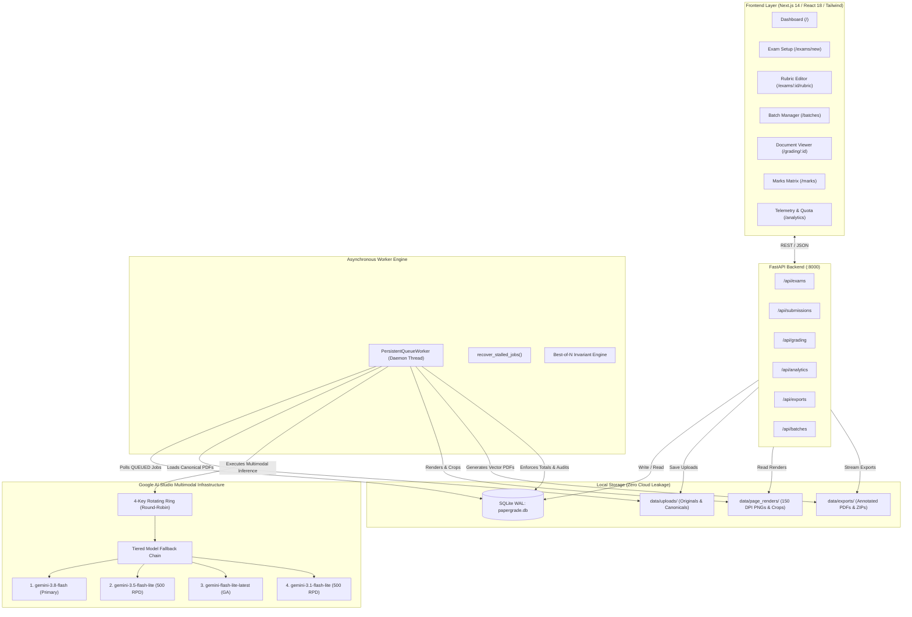
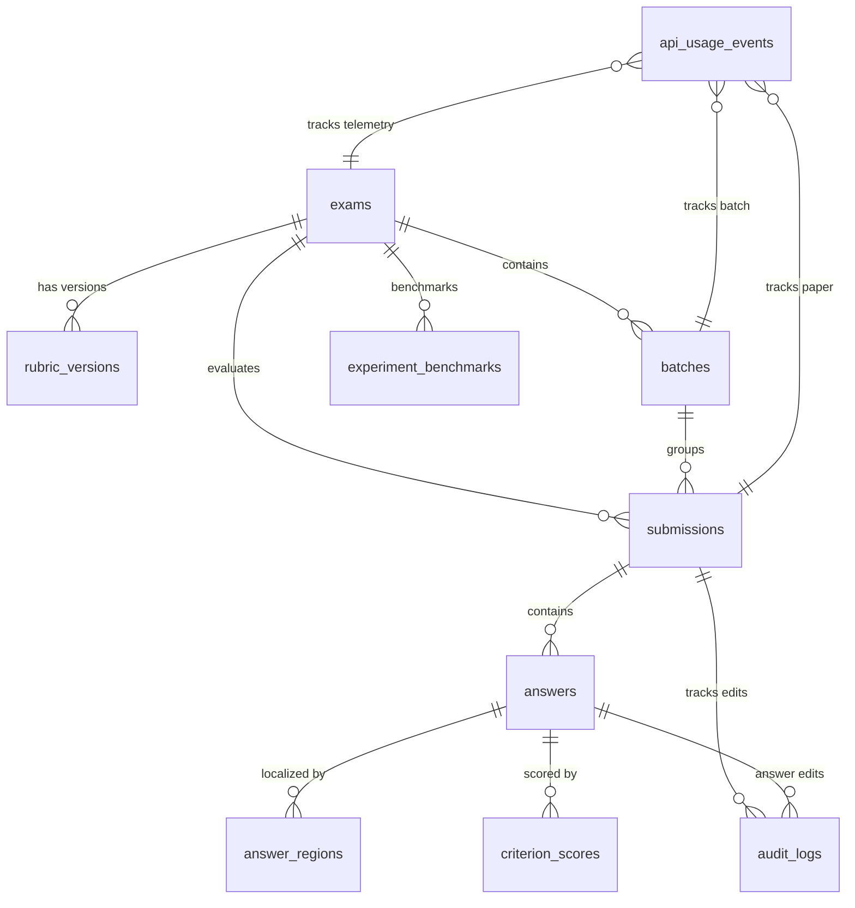
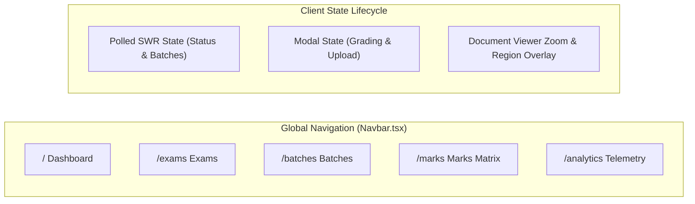
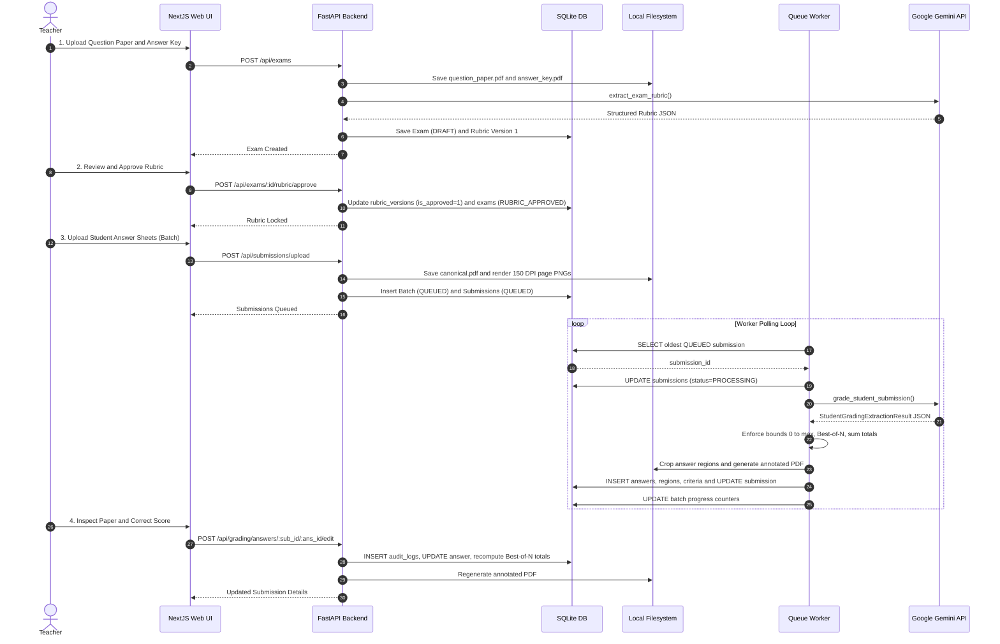

# PaperGrade AI — Complete System Architecture (A to Z)

PaperGrade AI is an enterprise-grade, local-first automated answer-sheet grading platform designed to experimentally validate whether the **Google Gemini Multimodal API** can reliably perform end-to-end handwriting transcription, question mapping, bounding-box localization, rubric grading, and evidence explanation in a single pass.

This document provides the definitive, exhaustive architecture breakdown covering **every module, file, class, function, database table, background worker, frontend state machine, and user interface page**.

---

## Table of Contents
1. [High-Level System Architecture](#1-high-level-system-architecture)
2. [Database Architecture & Data Models](#2-database-architecture--data-models)
3. [Backend Modules & Functions (A to Z)](#3-backend-modules--functions-a-to-z)
   - [Core & Configuration (`config.py`, `database.py`, `main.py`)](#31-core--configuration)
   - [Pydantic Schemas (`schemas.py`)](#32-pydantic-schemas)
   - [Gemini Multimodal Client (`gemini/`)](#33-gemini-multimodal-client)
   - [Services (`services/`)](#34-services)
   - [API Routers (`routers/`)](#35-api-routers)
   - [Persistent Queue Worker (`worker/`)](#36-persistent-queue-worker)
   - [Utility Scripts (`scripts/`)](#37-utility-scripts)
4. [Frontend Architecture & State Machines (A to Z)](#4-frontend-architecture--state-machines-a-to-z)
   - [Core Client & Types (`lib/api.ts`, `lib/types.ts`)](#41-core-client--types)
   - [Components (`components/`)](#42-components)
   - [Pages & Routing (`app/`)](#43-pages--routing)
5. [End-to-End Data & State Flow](#5-end-to-end-data--state-flow)
6. [Resilience, Failover & Quota Optimization](#6-resilience-failover--quota-optimization)

---

## 1. High-Level System Architecture

PaperGrade AI is architected with a decoupled, asynchronous, local-first topology:

---

## 2. Database Architecture & Data Models

The system uses local SQLite (`backend/data/papergrade.db`) configured with **WAL (Write-Ahead Logging)** mode (`PRAGMA journal_mode=WAL;`) and foreign keys enforced (`PRAGMA foreign_keys=ON;`).

### Table Definitions & Schemas

#### 1. `exams`
Stores top-level exam metadata and status.
- `id` (TEXT, PK): UUIDv4 identifier.
- `title` (TEXT, NOT NULL): Name of examination (e.g., "Physics Mid-Term Class XI").
- `subject` (TEXT, NOT NULL): Subject/Discipline.
- `total_marks` (REAL, NOT NULL, DEFAULT 0.0): Total maximum marks.
- `question_paper_path` (TEXT): Absolute path to uploaded question paper PDF/image.
- `answer_key_path` (TEXT): Absolute path to uploaded answer key PDF/image.
- `status` (TEXT, NOT NULL, DEFAULT 'DRAFT'): State (`DRAFT` or `RUBRIC_APPROVED`).
- `created_at` (TEXT, NOT NULL): ISO-8601 UTC timestamp.
- `updated_at` (TEXT, NOT NULL): ISO-8601 UTC timestamp.

#### 2. `rubric_versions`
Maintains version history of grading rubrics.
- `id` (TEXT, PK): UUIDv4 identifier.
- `exam_id` (TEXT, FK -> exams.id ON DELETE CASCADE).
- `version_num` (INTEGER, NOT NULL): Incremental version number (1, 2, ...).
- `is_approved` (INTEGER, NOT NULL, DEFAULT 0): Boolean flag (1=Approved source of truth, 0=Draft).
- `rubric_data` (TEXT, NOT NULL): Full serialized JSON schema (`ExamRubricExtractionResult`).
- `created_at` (TEXT, NOT NULL): ISO-8601 timestamp.
- `approved_at` (TEXT): ISO-8601 timestamp when approved.

#### 3. `batches`
Groups student paper submissions for batch grading.
- `id` (TEXT, PK): UUIDv4 identifier.
- `exam_id` (TEXT, FK -> exams.id ON DELETE CASCADE).
- `name` (TEXT, NOT NULL): Batch name (e.g., "Section A Morning").
- `status` (TEXT, NOT NULL, DEFAULT 'QUEUED'): State (`QUEUED`, `PROCESSING`, `COMPLETED`, `PARTIALLY_FAILED`, `PAUSED_QUOTA`).
- `total_submissions` (INTEGER, DEFAULT 0): Count of submissions in batch.
- `completed_submissions` (INTEGER, DEFAULT 0): Count of evaluated submissions (`COMPLETED` + `NEEDS_REVIEW`).
- `failed_submissions` (INTEGER, DEFAULT 0): Count of failed submissions.
- `created_at` (TEXT, NOT NULL): ISO-8601 timestamp.
- `updated_at` (TEXT, NOT NULL): ISO-8601 timestamp.

#### 4. `submissions`
Represents an individual student's examination paper.
- `id` (TEXT, PK): UUIDv4 identifier (`sub_<uuid>`).
- `batch_id` (TEXT, FK -> batches.id ON DELETE SET NULL).
- `exam_id` (TEXT, FK -> exams.id ON DELETE CASCADE).
- `student_name` (TEXT, NOT NULL): Student name (AI detected or teacher input).
- `roll_number` (TEXT, NOT NULL): Student roll/seat number.
- `original_file_path` (TEXT, NOT NULL): Original uploaded file on disk.
- `canonical_pdf_path` (TEXT, NOT NULL): Standardized multi-page PDF on disk.
- `page_count` (INTEGER, DEFAULT 1): Total pages in paper.
- `status` (TEXT, DEFAULT 'UPLOADED'): State (`UPLOADED`, `QUEUED`, `PROCESSING`, `NEEDS_REVIEW`, `COMPLETED`, `FAILED`).
- `error_message` (TEXT): Failure or pause description.
- `retry_count` (INTEGER, DEFAULT 0): Number of grading retry attempts.
- `total_awarded_marks` (REAL, DEFAULT 0.0): Backend-verified sum of awarded marks.
- `max_marks` (REAL, DEFAULT 0.0): Total achievable marks.
- `percentage` (REAL, DEFAULT 0.0): Percentage score ($0.0 - 100.0$).
- `is_manual_override` (INTEGER, DEFAULT 0): 1 if edited by teacher.
- `reviewed_at` (TEXT): ISO-8601 timestamp of teacher review.
- `created_at` (TEXT, NOT NULL): ISO-8601 timestamp.
- `updated_at` (TEXT, NOT NULL): ISO-8601 timestamp.

#### 5. `answers`
Individual evaluated answers mapped to rubric questions.
- `id` (TEXT, PK): UUIDv4 identifier.
- `submission_id` (TEXT, FK -> submissions.id ON DELETE CASCADE).
- `question_id` (TEXT, NOT NULL): Rubric question identifier (e.g., "Q1", "2(a)").
- `subquestion_id` (TEXT): Subquestion tag if applicable.
- `section_id` (TEXT): Section group (e.g., "sec_a").
- `is_extra_attempt` (INTEGER, DEFAULT 0): 1 if excluded by Best-of-N section limit.
- `page_number` (INTEGER, DEFAULT 1): Primary page number where answer appears.
- `extracted_text` (TEXT, DEFAULT ''): Verbatim handwritten student transcription.
- `max_marks` (REAL, DEFAULT 0.0): Question maximum mark.
- `awarded_marks` (REAL, DEFAULT 0.0): Awarded mark.
- `grading_rationale` (TEXT, DEFAULT ''): Explanation citing student text and rubric criteria.
- `transcription_uncertainty` (REAL, DEFAULT 0.0): Heuristic confidence ($0.0 - 1.0$).
- `grading_uncertainty` (REAL, DEFAULT 0.0): Marking confidence ($0.0 - 1.0$).
- `needs_review` (INTEGER, DEFAULT 0): 1 if human inspection recommended.
- `review_reason` (TEXT): Reason flagged for review.
- `is_missing` (INTEGER, DEFAULT 0): 1 if unattempted or missing.
- `is_manual_override` (INTEGER, DEFAULT 0): 1 if manually altered.
- `created_at` (TEXT, NOT NULL): ISO-8601 timestamp.
- `updated_at` (TEXT, NOT NULL): ISO-8601 timestamp.

#### 6. `answer_regions`
Normalized bounding boxes locating answers on page scans.
- `id` (TEXT, PK): UUIDv4 identifier.
- `answer_id` (TEXT, FK -> answers.id ON DELETE CASCADE).
- `page_number` (INTEGER, NOT NULL): 1-indexed page number.
- `x` (REAL, NOT NULL): Normalized X coordinate ($0.0 - 1.0$).
- `y` (REAL, NOT NULL): Normalized Y coordinate ($0.0 - 1.0$).
- `width` (REAL, NOT NULL): Normalized width ($0.0 - 1.0$).
- `height` (REAL, NOT NULL): Normalized height ($0.0 - 1.0$).
- `is_manual_override` (INTEGER, DEFAULT 0): 1 if repositioned/resized by teacher.
- `created_at` (TEXT, NOT NULL): ISO-8601 timestamp.

#### 7. `criterion_scores`
Granular criterion-level breakdown per answer.
- `id` (TEXT, PK): UUIDv4 identifier.
- `answer_id` (TEXT, FK -> answers.id ON DELETE CASCADE).
- `criterion_id` (TEXT, NOT NULL): Criterion identifier (e.g., "C1", "C2").
- `description` (TEXT, NOT NULL): Criterion description.
- `max_marks` (REAL, DEFAULT 0.0): Maximum criterion mark.
- `awarded_marks` (REAL, DEFAULT 0.0): Awarded criterion mark.
- `evidence` (TEXT, DEFAULT ''): Quoted snippet from student script.
- `is_manual_override` (INTEGER, DEFAULT 0): 1 if manually adjusted.
- `created_at` (TEXT, NOT NULL): ISO-8601 timestamp.

#### 8. `audit_logs`
Immutable audit log recording every teacher correction.
- `id` (TEXT, PK): UUIDv4 identifier.
- `submission_id` (TEXT, FK -> submissions.id ON DELETE CASCADE).
- `answer_id` (TEXT, FK -> answers.id ON DELETE SET NULL).
- `field_name` (TEXT, NOT NULL): Modified attribute (`awarded_marks`, `extracted_text`, `bounding_box`, etc.).
- `old_value` (TEXT): Pre-edit value.
- `new_value` (TEXT): Post-edit value.
- `reason` (TEXT): Teacher's rationale for modification.
- `edited_by` (TEXT, DEFAULT 'teacher'): Author of change.
- `created_at` (TEXT, NOT NULL): ISO-8601 timestamp.

#### 9. `api_usage_events`
Telemetry recording every Gemini API transaction.
- `id` (TEXT, PK): UUIDv4 identifier.
- `timestamp` (TEXT, NOT NULL): ISO-8601 UTC timestamp.
- `exam_id` (TEXT): Exam UUID.
- `batch_id` (TEXT): Batch UUID.
- `submission_id` (TEXT): Submission UUID.
- `request_purpose` (TEXT, NOT NULL): `EXAM_SETUP` or `SUBMISSION_GRADING`.
- `model_name` (TEXT, NOT NULL): Actual model invoked (`gemini-3.8-flash`, `gemini-3.5-flash-lite`, etc.).
- `input_tokens` (INTEGER): Prompt tokens consumed.
- `output_tokens` (INTEGER): Response tokens generated.
- `total_tokens` (INTEGER): Total token count.
- `thinking_tokens` (INTEGER): Extended thinking tokens.
- `cached_tokens` (INTEGER): Cached token count.
- `duration_ms` (INTEGER, NOT NULL): Round-trip latency in milliseconds.
- `page_count` (INTEGER): Number of pages evaluated.
- `file_size_bytes` (INTEGER): Payload size in bytes.
- `success` (INTEGER, NOT NULL): 1 for 200 OK, 0 for failure.
- `http_status` (INTEGER): HTTP status code (200, 429, 503, etc.).
- `error_code` (TEXT): Exception details on error.
- `retry_attempt` (INTEGER, DEFAULT 0): Attempt index.
- `estimated_cost_usd` (REAL): Paid-equivalent price in USD.
- `pricing_version` (TEXT, NOT NULL): Price schedule key.
- `is_mock` (INTEGER, DEFAULT 0): 1 if synthetic mock fixture.

#### 10. `user_quota_settings`
Configurable rate limit parameters for projection calculations.
- `id` (TEXT, PK): Record ID (`default`).
- `rpm_limit` (INTEGER, DEFAULT 15): Requests Per Minute.
- `tpm_limit` (INTEGER, DEFAULT 1000000): Tokens Per Minute.
- `rpd_limit` (INTEGER, DEFAULT 1500): Requests Per Day.
- `updated_at` (TEXT, NOT NULL): ISO-8601 timestamp.

#### 11. `experiment_benchmarks`
Teacher benchmark verification for academic accuracy tracking.
- `id` (TEXT, PK): UUIDv4 identifier.
- `exam_id` (TEXT, FK -> exams.id ON DELETE CASCADE).
- `submission_id` (TEXT, FK -> submissions.id ON DELETE CASCADE).
- `ground_truth_marks` (REAL): Actual human ground-truth score.
- `ground_truth_answers_json` (TEXT): Ground truth answers.
- `transcription_accepted` (INTEGER, DEFAULT 1): Flag.
- `mapping_correct` (INTEGER, DEFAULT 1): Flag.
- `box_accepted` (INTEGER, DEFAULT 1): Flag.
- `marks_matched` (INTEGER, DEFAULT 1): Flag.
- `explanation_sufficient` (INTEGER, DEFAULT 1): Flag.
- `manual_intervention_required` (INTEGER, DEFAULT 0): Flag.
- `notes` (TEXT): Qualitative notes.
- `created_at` (TEXT, NOT NULL): ISO-8601 timestamp.

---

## 3. Backend Modules & Functions (A to Z)

### 3.1 Core & Configuration

#### `backend/app/config.py`
Defines application configuration, environment parsing, and directory setup.
- **`Settings` Class**:
  - `APP_NAME: str`: `"PaperGrade AI"`.
  - `APP_VERSION: str`: `"1.0.0-phase1-poc"`.
  - `DEBUG: bool`: Debug toggle from `DEBUG` env var.
  - `HOST: str`, `PORT: int`: Network binding (`127.0.0.1:8000`).
  - `GEMINI_API_KEY`, `GEMINI_API_KEY_2`, `GEMINI_API_KEY_3`, `GEMINI_API_KEY_4`: 4 API key slots loaded from root `.env`.
  - `GEMINI_MODEL: str`: Flagship model (`gemini-3.8-flash`).
  - `DATA_DIR`, `UPLOADS_DIR`, `RENDERS_DIR`, `EXPORTS_DIR`, `DATABASE_PATH`: Local storage paths.
  - `DEFAULT_RPM_LIMIT`, `DEFAULT_TPM_LIMIT`, `DEFAULT_RPD_LIMIT`: Quota limit defaults.
  - `PRICING_VERSION: str`: `"2026-03-gemini-flash"`.
  - `ensure_directories()`: Creates `./data/uploads`, `./data/page_renders`, `./data/exports` if absent.
  - `configured_api_keys -> List[str]`: Filters and returns valid configured API keys.
  - `is_gemini_configured -> bool`: Returns `True` if at least 1 key is present.

#### `backend/app/database.py`
Database connection pooling, context management, and schema initialization.
- `get_iso_now() -> str`: Returns current UTC timestamp in ISO-8601 format.
- `get_db_connection() -> sqlite3.Connection`: Connects to `papergrade.db` with `timeout=30.0`, `row_factory=sqlite3.Row`, `WAL` journal mode, and `foreign_keys=ON`.
- `get_db()`: Context manager yielding an active connection, auto-committing on completion and rolling back on unhandled exceptions.
- `init_db()`: Creates all 11 database tables, sets indexes, and applies incremental migrations.

#### `backend/app/main.py`
FastAPI application definition and lifecycle orchestrator.
- `lifespan(app: FastAPI)`: Startup hook initializing SQLite schema (`init_db()`) and launching background queue worker (`queue_worker.start()`); shutdown hook cleanly stopping worker (`queue_worker.stop()`).
- `get_batches_shortcut(exam_id: Optional[str])`: Compatibility GET endpoint for `/api/batches`.
- `health_check() -> Dict`: Health check reporting app version, live Gemini status, and active model.
- `system_status() -> Dict`: Returns counts of exams, submissions, queued jobs, API calls, and storage paths.

---

### 3.2 Pydantic Schemas

Located in `backend/app/schemas.py`.

- **`ExamSection`**: Section definition (`section_id`, `title`, `instructions`, `total_questions`, `attempt_limit`, `max_marks`, `question_ids`).
- **`RubricCriterion`**: Evaluation criterion (`criterion_id`, `description`, `marks`).
- **`RubricQuestion`**: Question rubric (`question_id`, `subquestion_id`, `section_id`, `question_text`, `max_marks`, `official_answer`, `accepted_alternatives`, `criteria`, `numerical_tolerances`, `grading_notes`).
- **`ExamRubricExtractionResult`**: Top-level rubric structure extracted by Gemini (`exam_title`, `subject`, `total_marks`, `sections`, `questions`).
- **`AnswerRegionItem`**: Normalized bounding box ($[0.0, 1.0]$) with self-clamping validator (`page_number`, `x`, `y`, `width`, `height`).
- **`CriterionScoreItem`**: Evaluated criterion score (`criterion_id`, `description`, `max_marks`, `awarded_marks`, `evidence`).
- **`GradedAnswerItem`**: Single evaluated student answer with uncertainty flags (`question_id`, `subquestion_id`, `section_id`, `is_extra_attempt`, `page_number`, `extracted_student_answer`, `regions`, `max_marks`, `awarded_marks`, `criterion_scores`, `grading_rationale`, `transcription_uncertainty`, `grading_uncertainty`, `needs_review`, `review_reason`, `is_missing`).
- **`StudentGradingExtractionResult`**: Structured output schema returned by Gemini for full paper grading (`submission_identifier`, `student_name_detected`, `roll_number_detected`, `answers`).
- **`RubricApproveRequest`**: Request wrapper for approving rubrics (`rubric_data`).
- **`ManualEditAnswerRequest`**: Payload for human teacher edits (`awarded_marks`, `extracted_text`, `grading_rationale`, `question_id`, `needs_review`, `reason`, `criterion_scores`).
- **`ManualEditRegionRequest`**: Payload for human bounding-box adjustments (`page_number`, `x`, `y`, `width`, `height`, `reason`).
- **`QuotaSettingsUpdateRequest`**: Form input for updating rate limits (`rpm_limit`, `tpm_limit`, `rpd_limit`).
- **`BenchmarkRecordRequest`**: Input payload for recording teacher accuracy assessments.

---

### 3.3 Gemini Multimodal Client

Located in `backend/app/gemini/client.py`, `pricing.py`, and `prompts.py`.

#### `backend/app/gemini/client.py`
- **`AllGeminiKeysExhaustedError`**: Custom exception raised when all keys across all fallback models hit rate/quota exhaustion.
- **`is_rate_or_quota_error(e: Exception) -> bool`**: Evaluates exception codes (429, 503) and messages to detect rate limits, resource exhaustion, or high-demand throttling.
- **`GeminiGradingClient` Class**:
  - `__init__()`: Initializes `candidate_models` hierarchy (`[GEMINI_MODEL, "gemini-3.5-flash-lite", "gemini-flash-lite-latest", "gemini-3.1-flash-lite"]`), sets up 30-minute cooldown cache (`_model_cooldown_until`), and instantiates a `genai.Client` for each configured key.
  - `get_active_models() -> List[str]`: Filters out candidate models currently on active cooldown.
  - `get_current_client() -> Tuple[str, genai.Client]`: Returns currently active API key and client instance.
  - `rotate_to_next_key(reason: str) -> str`: Round-robin advances to the next API key in the pool, printing a failover audit message.
  - `_record_usage_event(...) -> str`: Calculates paid-equivalent cost via `pricing.py` and logs transaction to `api_usage_events`.
  - `extract_exam_rubric(exam_id, question_paper_path, answer_key_path, extra_notes) -> Tuple[ExamRubricExtractionResult, str]`: Reads question paper and answer key PDFs, constructs prompt, and iterates through candidate models and keys to extract structured rubric.
  - `grade_student_submission(exam_id, batch_id, submission_id, student_pdf_path, rubric_json, page_count) -> Tuple[StudentGradingExtractionResult, str]`: Transcribes, maps, localizes, grades, and explains student script in a single multimodal call with multi-key failover and model fallback.

#### `backend/app/gemini/pricing.py`
- `calculate_paid_equivalent_cost(input_tokens, output_tokens, cached_tokens, thinking_tokens, model_name) -> float`: Calculates paid-equivalent USD estimate using Google AI Studio pricing rates ($0.075 / 1M input, $0.300 / 1M output, $0.01875 / 1M cached).

#### `backend/app/gemini/prompts.py`
- `RUBRIC_EXTRACTION_SYSTEM_INSTRUCTION`: System directive for exam rubric extraction, enforcing question parsing, section detection, and attempt limits.
- `STUDENT_GRADING_SYSTEM_INSTRUCTION`: System directive for handwritten student grading, constraining transcription accuracy, normalized bounding boxes, criterion grading, and uncertainty rating.
- `build_rubric_extraction_prompt(extra_notes: str) -> str`: Formats user prompt for rubric extraction.
- `build_student_grading_prompt(rubric_json_str: str) -> str`: Injects confirmed rubric JSON into student evaluation prompt.

---

### 3.4 Services

#### `backend/app/services/exam_service.py`
- `create_exam(title, subject, question_paper_path, answer_key_path, extra_notes) -> Dict`: Creates exam record and triggers initial Gemini rubric extraction if documents are provided.
- `save_rubric_version(exam_id, rubric, is_approved) -> str`: Increments rubric version number, stores serialized JSON, and updates exam total marks.
- `approve_rubric(exam_id, rubric) -> Dict`: Marks rubric version as approved (`is_approved=1`) and transitions exam status to `RUBRIC_APPROVED`.
- `unlock_rubric(exam_id) -> Dict`: Resets rubric approval state and returns exam to `DRAFT`.
- `get_exam(exam_id) -> Optional[Dict]`: Retrieves exam details along with its latest/approved rubric.
- `list_exams() -> List[Dict]`: Lists all exams with `has_approved_rubric` flag.

#### `backend/app/services/grading_service.py`
- `apply_best_of_n_and_compute_totals(cursor, submission_id, rubric_data, now) -> Tuple[float, float, float, bool]`: Enforces section attempt limits ("Attempt any X out of Y"). Sorts attempted answers by score descending, keeps top X, flags lower excess answers with `is_extra_attempt = 1`, and computes final percentage.
- `enforce_invariants_and_save(submission_id, exam_id, grading_result, rubric_data)`: Alias for `process_submission`.
- `process_submission(submission_id, grading_result, rubric_data) -> Dict`: Validates marks within $[0, \text{max}]$, validates criterion score sums, clamps bounding boxes to $[0.0, 1.0]$, preserves prior teacher overrides, saves answers/regions/criteria, triggers crop generation, and renders annotated export PDF.
- `generate_answer_crops_for_submission(submission_id)`: Generates cropped PNG images for all answer regions.
- `generate_export_pdf_for_submission(submission_id)`: Calls PyMuPDF vector overlay service to render annotated PDF.
- `get_submission_details(submission_id) -> Optional[Dict]`: Compiles submission record, exam metadata, approved rubric, answers, regions, crop URLs, criterion scores, and audit logs.
- `manual_edit_answer(submission_id, answer_id, edit_req) -> Dict`: Updates marks, transcription, rationale, or review flag, writes entry to `audit_logs`, recalculates Best-of-N totals, and re-renders export PDF.
- `manual_edit_region(submission_id, region_id, edit_req) -> Dict`: Updates bounding box coordinates, writes audit log, crops new preview image, and updates export PDF.

#### `backend/app/services/pdf_service.py`
- `validate_file(file_path, max_size_mb=50) -> Tuple[bool, str]`: Checks file existence, size, and supported extensions (`.pdf`, `.png`, `.jpg`, `.jpeg`, `.webp`, `.bmp`).
- `_image_to_upright_pdf_bytes(img_path: Path) -> bytes`: Normalizes mobile camera orientation using EXIF transposition (`ImageOps.exif_transpose`) and converts to 150 DPI PDF bytes.
- `files_to_canonical_pdf(file_paths, output_pdf_path) -> Path`: Assembles a list of images and/or PDFs into a single unified multi-page PDF using PyMuPDF.
- `images_to_pdf(image_paths, output_pdf_path) -> Path`: Converts image files to a single upright multi-page PDF.
- `render_pdf_pages_to_images(pdf_path, submission_id, dpi=150) -> List[Path]`: Renders each page of a PDF into high-resolution PNG (`page_1.png`, etc.) at 150 DPI for the interactive Document Viewer.
- `crop_answer_region(page_img_path, x, y, width, height, output_crop_path) -> Optional[Path]`: Crops bounding box region from rendered page image using Pillow.
- `generate_annotated_pdf(orig_pdf_path, output_pdf_path, answers_data, total_awarded_marks, max_marks, student_name, roll_number) -> Path`: Draws vector rectangles, question labels, awarded mark pills, and a master header onto the original PDF using PyMuPDF vector drawing primitives.

#### `backend/app/services/usage_service.py`
- `get_quota_settings() -> Dict`: Fetches configured RPM, TPM, and RPD limits.
- `update_quota_settings(update_data) -> Dict`: Upserts quota limits in `user_quota_settings`.
- `get_usage_metrics(exam_id, batch_id) -> Dict`: Computes total requests, success rate, retry rate, latency percentiles ($P_{50}$, $P_{95}$), token statistics, cost summaries, and batch feasibility projections for 40 and 50 papers.
- `_calculate_batch_projection(batch_size, avg_in, p90_in, avg_out, p90_out, avg_cost, p90_cost, retry_rate, avg_duration, p95_duration, rpm, tpm, rpd) -> Dict`: Models average and conservative ($P_{90}$) token consumption, cost, pacing delay, and quota feasibility.
- `_percentile(data, p) -> float`: Computes mathematical percentile from a sorted float array.

#### `backend/app/services/export_service.py`
- `get_submission_pdf_path(submission_id) -> Optional[Path]`: Returns path to annotated PDF, generating on-demand if missing.
- `create_batch_zip(batch_id) -> Optional[Path]`: Packages all annotated student PDFs in a batch into a single ZIP archive.
- `generate_exam_marks_csv(exam_id) -> str`: Generates CSV string containing roll number, student name, per-question marks, total marks, percentage, status, and review flags.

---

### 3.5 API Routers

#### `backend/app/routers/exams.py` (`/api/exams`)
- `GET /`: `list_exams()` — Returns all exams with rubric approval status.
- `GET /{exam_id}`: `get_exam(exam_id)` — Fetches exam details and approved rubric.
- `POST /`: `create_exam(...)` — Handles multipart upload of question paper and answer key, saves files, and extracts rubric.
- `POST /{exam_id}/rubric/approve`: `approve_rubric(exam_id, req)` — Approves rubric.
- `POST /{exam_id}/rubric/unlock`: `unlock_rubric(exam_id)` — Unlocks rubric back to draft mode.
- `POST /load-sample`: `load_sample_exam()` — Seeds a sample Physics exam and queues 3 sample student papers.

#### `backend/app/routers/submissions.py` (`/api/submissions`)
- `POST /upload`: `upload_submissions(...)` — Accepts student files, handles "single student multi-page" or "batch mode", creates canonical PDFs, renders page PNGs, and queues submissions.
- `GET /{submission_id}`: `get_submission(submission_id)` — Returns full submission details.
- `GET /batches/all`: `list_batches(exam_id)` — Returns all batches.
- `GET /batch/{batch_id}`: `get_batch(batch_id)` — Returns batch details and member submissions.
- `GET /exam/{exam_id}`: `get_exam_submissions(exam_id)` — Returns all submissions for an exam.
- `POST /{submission_id}/regrade`: `regrade_submission(submission_id)` — Resets submission status to `QUEUED` for re-grading.

#### `backend/app/routers/grading.py` (`/api/grading`)
- `POST /answers/{submission_id}/{answer_id}/edit`: `edit_answer(...)` — Updates answer score, text, or rationale with audit log.
- `POST /regions/{submission_id}/{region_id}/edit`: `edit_region(...)` — Updates bounding box coordinates with audit log.
- `GET /page-image/{submission_id}/{page_num}`: `get_page_image(...)` — Streams 150 DPI rendered page PNG.
- `GET /crop/{submission_id}/{answer_id}`: `get_answer_crop(...)` — Streams cropped answer PNG.

#### `backend/app/routers/analytics.py` (`/api/analytics`)
- `GET /usage`: `get_usage(exam_id, batch_id)` — Telemetry summary, latency percentiles, and batch projections.
- `POST /quota`: `update_quota_settings(req)` — Updates rate limit configuration.
- `POST /benchmark`: `record_benchmark(req)` — Records teacher verification data.
- `GET /benchmarks/{exam_id}`: `get_exam_benchmarks(exam_id)` — Aggregates accuracy percentages (transcription, mapping, localization, marks).

#### `backend/app/routers/exports.py` (`/api/exports`)
- `GET /pdf/{submission_id}`: `download_annotated_pdf(...)` — Downloads vector-annotated student PDF.
- `GET /pdf/{submission_id}/{filename}`: Named variant for browser download.
- `GET /batch-zip/{batch_id}`: `download_batch_zip(...)` — Downloads ZIP archive of all annotated PDFs in batch.
- `GET /batch-zip/{batch_id}/{filename}`: Named variant for browser download.
- `GET /marks-csv/{exam_id}`: `download_marks_csv(...)` — Downloads class marks CSV.
- `GET /marks-csv/{exam_id}/{filename}`: Named variant for browser download.

---

### 3.6 Persistent Queue Worker

Located in `backend/app/worker/queue_worker.py`.

- **`PersistentQueueWorker` Class**:
  - `__init__(poll_interval_sec=2.0)`: Initializes polling loop state.
  - `start()`: Executes `recover_stalled_jobs()` and starts daemon thread.
  - `stop()`: Signals thread shutdown and joins thread.
  - `recover_stalled_jobs()`: Startup crash recovery: resets any submissions stuck in `PROCESSING` back to `QUEUED`, and resumes any batches in `PAUSED_QUOTA` back to `PROCESSING`.
  - `_run_loop()`: Background loop polling for jobs. Implements a 3.5s pacing delay between completed jobs to prevent rate-limit bursts.
  - `process_next_job() -> bool`:
    1. Fetches oldest `QUEUED` submission from SQLite and locks it as `PROCESSING`.
    2. Fetches approved rubric for the exam.
    3. Calls `gemini_client.grade_student_submission(...)`.
    4. Passes extracted result to `grading_service.enforce_invariants_and_save(...)`.
    5. Updates batch progress counters.
    6. Catches `AllGeminiKeysExhaustedError`: sets submission to `QUEUED`, sets batch to `PAUSED_QUOTA`, and sleeps for a 60-second cooldown without marking papers as `FAILED`.
    7. Catches generic exceptions: retries up to 3 times before marking `FAILED`.
  - `_update_batch_progress(batch_id: str)`: Aggregates counts of completed, needs-review, and failed papers, marking batch `COMPLETED` when all papers finish.

---

### 3.7 Utility Scripts

- **`backend/scripts/compile_batch_pages.py`**: Merges separate page image uploads into a single multi-page canonical PDF and updates database records.
- **`backend/app/scripts/reset_db.py`**: Drops and recreates all database tables for a fresh development environment.

---

## 4. Frontend Architecture & State Machines (A to Z)

The frontend is built with **Next.js 14 (App Router)**, **TypeScript**, **Tailwind CSS**, and **Lucide React** icons.

### 4.1 Core Client & Types

#### `frontend/src/lib/types.ts`
Defines TypeScript interfaces mirroring backend schemas: `RubricCriterion`, `ExamSection`, `RubricQuestion`, `ExamRubric`, `Exam`, `AnswerRegion`, `CriterionScore`, `GradedAnswer`, `AuditLog`, `Submission`, `Batch`, `QuotaSettings`, `BatchProjection`, `UsageMetrics`, `BenchmarkSummary`.

#### `frontend/src/lib/api.ts`
Type-safe HTTP client wrapping browser `fetch`:
- `getStatus()`: Fetches `/api/status`.
- `listExams()`, `getExam()`, `createExam()`, `approveRubric()`, `unlockRubric()`, `loadSampleExam()`.
- `uploadSubmissions()`, `getSubmission()`, `getBatch()`, `listBatches()`, `regradeSubmission()`.
- `editAnswer()`, `editRegion()`.
- `getUsageMetrics()`, `updateQuotaSettings()`, `recordBenchmark()`, `getBenchmarks()`.
- URL Generators: `getAnnotatedPdfUrl()`, `getBatchZipUrl()`, `getMarksCsvUrl()`, `getPageImageUrl()`, `getCropImageUrl()`.

---

### 4.2 Components

#### 1. `Navbar.tsx`
- Global navigation header.
- Displays live backend connection pill (Active model, Live vs Mock mode, active API key count).
- Navigation links: Dashboard, Exams, Batches, Marks Matrix, Analytics.

#### 2. `DocumentViewer.tsx`
- Interactive multi-page script viewer.
- Renders 150 DPI page scans (`/api/grading/page-image/{sub_id}/{page}`).
- SVG overlay displaying normalized bounding boxes with semantic color coding:
  - **Green**: Full marks ($= \text{max}$).
  - **Amber**: Partial marks ($> 0, < \text{max}$).
  - **Rose**: Zero marks ($= 0$).
  - **Violet**: Review required (`needs_review=true`).
- Controls: Page navigation, zoom in/out, fit-to-width, answer highlight on selection.

#### 3. `GradingModal.tsx`
- Detailed answer inspection modal opened when clicking an answer region.
- Displays:
  - Cropped handwriting image from the student's script.
  - Verbatim AI transcription.
  - Question text & official rubric solution.
  - Criterion score breakdown with evidence citations.
  - Teacher override inputs (adjust awarded marks, edit transcription, modify rationale, toggle review).
  - Complete audit log trail of previous human edits.

#### 4. `MarksTable.tsx`
- Class results matrix displaying all students in rows and all rubric questions in columns.
- Displays question-by-question marks, total marks, percentage, and review badges.
- Search by student name/roll number; status filtering (`All`, `Completed`, `Needs Review`, `Pending`).
- One-click "Export CSV" button.

#### 5. `RubricEditor.tsx`
- Interactive exam rubric configuration tool.
- Supports Section management (Section Title, Instructions, Total Questions, Attempt Limit, Section Max Marks).
- Supports Question management (Question ID, Max Marks, Question Text, Official Answer, Criteria breakdown).
- Rubric Lock/Approve button ensuring rubrics are finalized before student upload.

#### 6. `UsageCards.tsx`
- Telemetry dashboard cards.
- Displays:
  - Total requests, success rate, retry rate, total spent.
  - Latency percentiles ($P_{50}$, $P_{95}$).
  - Per-paper token averages and estimated cost.
  - 40-paper and 50-paper feasibility projection cards.
  - Interactive quota configuration form to update RPM, TPM, and RPD.

---

### 4.3 Pages & Routing

#### `frontend/src/app/page.tsx` (`/`)
- Main teacher dashboard.
- Displays system status overview cards (Exams, Submissions, Queued Jobs, Telemetry).
- Quick Action buttons: "Create New Exam", "Upload Student Batch", "Load Sample Exam".
- Table of recent examinations and recent batches.

#### `frontend/src/app/exams/page.tsx` (`/exams`)
- Exam catalog listing all created examinations.
- Displays subject, total marks, status (`DRAFT` vs `RUBRIC_APPROVED`), and action links (`Manage Rubric`, `Create Batch`).

#### `frontend/src/app/exams/new/page.tsx` (`/exams/new`)
- Exam creation wizard.
- Form fields: Exam Title, Subject, Additional Notes.
- File upload for Question Paper and Answer Key (supports multi-file selection and PDF/image formats).
- Automatically triggers AI draft extraction upon upload.

#### `frontend/src/app/exams/[id]/rubric/page.tsx` (`/exams/[id]/rubric`)
- Rubric management interface for a specific exam.
- Loads existing rubric version, allows interactive editing, and provides "Approve & Lock Rubric" or "Unlock Rubric" buttons.

#### `frontend/src/app/batches/page.tsx` (`/batches`)
- Batch management and upload hub.
- Upload modal features:
  - Dynamic file inspection: binary inspection detects PDFs vs images, counts pages, and displays dynamic summary (e.g. `25 PDFs (128 pages)`).
  - Upload lockout: disables all inputs, close buttons, and file removals during upload to prevent race conditions.
  - Single student vs Batch mode toggles.
- Lists all active and completed batches with progress bars, completion counts, and `PAUSED_QUOTA` indicators.

#### `frontend/src/app/batches/[id]/page.tsx` (`/batches/[id]`)
- Batch detail view.
- Tab 1: Submissions list with search, status filters (`ALL`, `COMPLETED`, `NEEDS_REVIEW`, `PROCESSING`, `QUEUED`), student score pills, and "Re-grade" triggers.
- Tab 2: Integrated `MarksTable` for the batch.
- Batch action: "Download Batch ZIP".

#### `frontend/src/app/grading/[id]/page.tsx` (`/grading/[id]`)
- Primary grading workspace for an individual student paper.
- Left panel: DocumentViewer displaying original scans with interactive bounding boxes.
- Right panel: Answer navigator listing all questions with scores, missing badges, and review indicators.
- Clicking any question opens `GradingModal` for detailed inspection and manual override.
- Action: "Download Annotated PDF".

#### `frontend/src/app/marks/page.tsx` (`/marks`)
- Dedicated marks view.
- Exam dropdown selector to load class matrix.
- Embeds `MarksTable` with CSV export.

#### `frontend/src/app/analytics/page.tsx` (`/analytics`)
- System feasibility and benchmark analytics.
- Embeds `UsageCards` for live API metrics and 40/50 batch projections.
- Displays Ground-Truth Benchmark agreement statistics (transcription, mapping, localization, marking accuracy).

---

## 5. End-to-End Data & State Flow

---

## 6. Resilience, Failover & Quota Optimization

### Multi-Key Rotating Failover
Google AI Studio enforces free-tier rate limits per API key (e.g. 15 RPM). PaperGrade AI implements a rotating key ring in `GeminiGradingClient`:
- Discovers up to 4 configured keys (`GEMINI_API_KEY_1` through `_4`).
- Upon encountering HTTP `429 RESOURCE_EXHAUSTED` or HTTP `503 UNAVAILABLE`, the client logs a failover event and rotates to the next key in the ring.

### 4-Tier Model Fallback
Free-tier daily quotas are enforced **per project per model**:
- **Primary**: `gemini-3.8-flash` (20 RPD cap per key).
- **Fallback 1**: `gemini-3.5-flash-lite` (**500 RPD** per key = 2,000 papers/day).
- **Fallback 2**: `gemini-flash-lite-latest` (GA stable alias).
- **Fallback 3**: `gemini-3.1-flash-lite` (**500 RPD** per key).

When all 4 keys exhaust their quota on a model:
1. The client places that model into a **30-minute cooldown cache** (`_model_cooldown_until`).
2. It transitions immediately to the next fallback model without pausing the worker.
3. Subsequent papers skip the exhausted model, avoiding wasted 429 requests.

### Graceful Queue Pause & Startup Recovery
If all configured models across all keys exhaust their quotas:
1. The client raises `AllGeminiKeysExhaustedError`.
2. The queue worker updates the active submission back to `QUEUED` with error message `"Quota Paused"`.
3. The batch status transitions to `PAUSED_QUOTA`.
4. The worker enters a 60-second cooldown loop without marking any papers as `FAILED`.
5. Upon application reboot or daily quota reset, `recover_stalled_jobs()` automatically detects any `PAUSED_QUOTA` batches, restores them to `PROCESSING`, and resumes evaluation seamlessly from the exact paper where it stopped.
