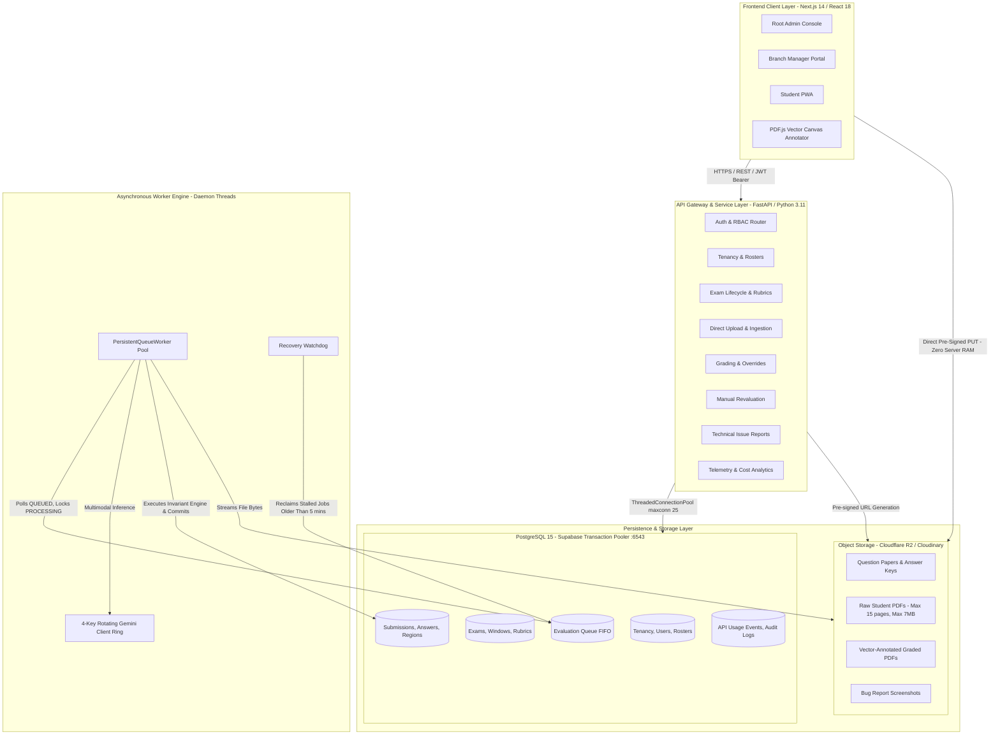
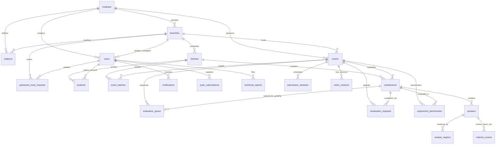
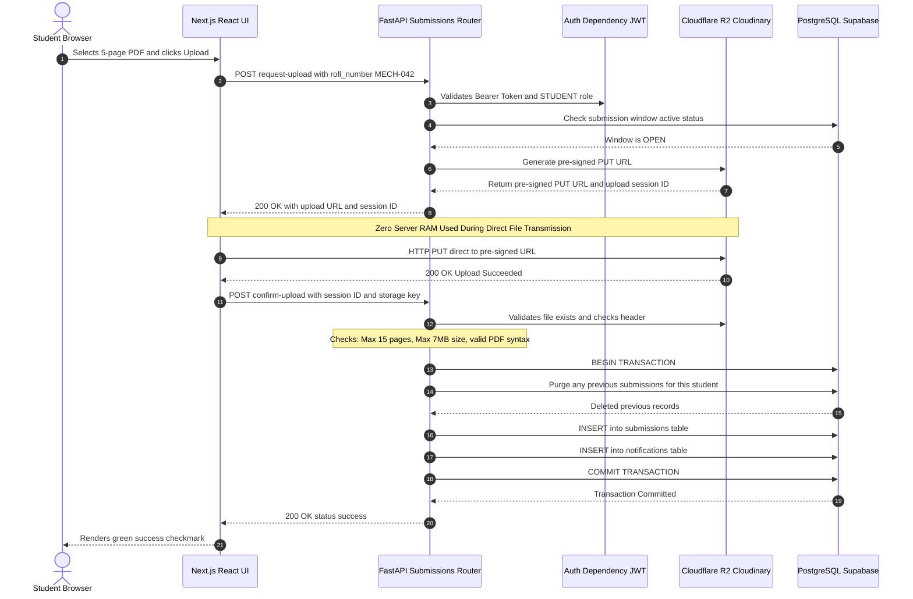
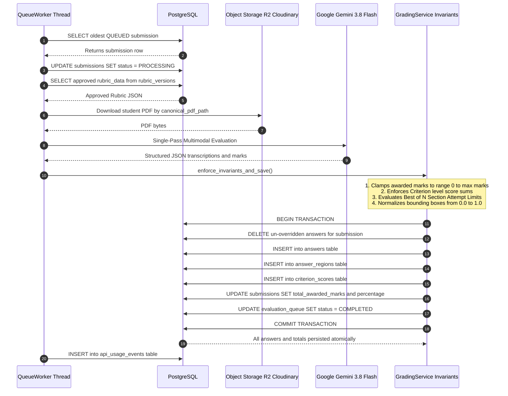
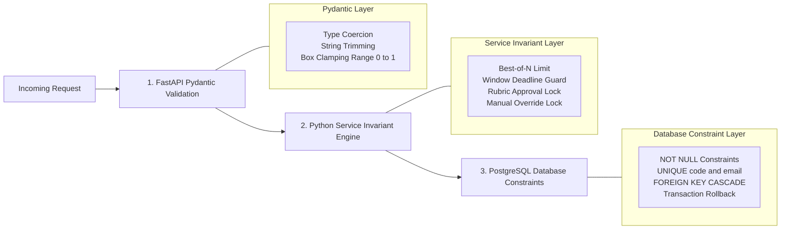

# PaperGrade AI — PostgreSQL Database Architecture & Technical Interview Guide

> **Target Audience:** Associate Data Engineer / Backend Engineer Interview Preparation  
> **Repository:** PaperGrade AI (Multi-Tenant Automated Answer Sheet Evaluation Platform)  
> **Core Stack:** React / Next.js 14 (Frontend) • Python FastAPI (Backend API) • PostgreSQL / Supabase (Database) • Google Gemini Multimodal API (Inference Engine)  
> **Document Status:** Reverse-Engineered from Verified Repository Source Code  
> **Date:** October 2026  

---

## Table of Contents

1. [Executive Summary & 60–90s Verbal Introduction](#1-executive-summary--6090s-verbal-introduction)
2. [Technology Stack & System Topology](#2-technology-stack--system-topology)
3. [Repository Map & Component Responsibilities](#3-repository-map--component-responsibilities)
4. [PostgreSQL Database Connectivity & Session Management](#4-postgresql-database-connectivity--session-management)
5. [Complete Schema Inventory (24 Verified Database Tables)](#5-complete-schema-inventory-24-verified-database-tables)
6. [Entity-Relationship (ER) Diagram & Relational Cardinalities](#6-entity-relationship-er-diagram--relational-cardinalities)
7. [Database Design, Normalization, & Denormalization Analysis](#7-database-design-normalization--denormalization-analysis)
8. [Indexes, Query Execution Plans, & Performance Engineering](#8-indexes-query-execution-plans--performance-engineering)
9. [Transactions, Concurrency, Locking, & ACID Guarantees](#9-transactions-concurrency-locking--acid-guarantees)
10. [End-to-End Data Flows (3 Complete Traced Workflows)](#10-end-to-end-data-flows-3-complete-traced-workflows)
11. [FastAPI and Database Boundary Integration](#11-fastapi-and-database-boundary-integration)
12. [SQL Query Inventory & Execution Patterns](#12-sql-query-inventory--execution-patterns)
13. [Database Migrations & Schema Evolution](#13-database-migrations--schema-evolution)
14. [Data Retention, Storage Lifecycle, & Purging Policy](#14-data-retention-storage-lifecycle--purging-policy)
15. [Error Handling, Invariants, & Data Integrity](#15-error-handling-invariants--data-integrity)
16. [Security Architecture & Configuration](#16-security-architecture--configuration)
17. [Testing, CI/CD, & Deployment Architecture](#17-testing-cicd--deployment-architecture)
18. [Data Engineering, Scalability, & Reliability Considerations](#18-data-engineering-scalability--reliability-considerations)
19. [Technical Interview Preparation & Defense Guide](#19-technical-interview-preparation--defense-guide)
    - [19.1 Verbal Elevator Pitches & Walkthroughs](#191-verbal-elevator-pitches--walkthroughs)
    - [19.2 25+ Project-Specific Technical Interview Questions & Model Answers](#192-25-project-specific-technical-interview-questions--model-answers)
    - [19.3 Architectural Trade-Off Defenses](#193-architectural-trade-off-defenses)
    - [19.4 Knowledge Gaps & Production Follow-Ups](#194-knowledge-gaps--production-follow-ups)
20. [Source Code Reference Index](#20-source-code-reference-index)

---

## 1. Executive Summary & 60–90s Verbal Introduction

### 1.1 What the Application Does
**PaperGrade AI** is a multi-tenant, AI-assisted answer-sheet evaluation platform designed for coaching institutes and educational institutions operating multiple branch campuses. It automates handwritten exam grading by leveraging Google's Gemini Multimodal AI to perform single-pass handwriting transcription, question mapping, bounding-box localization, rubric grading, and evidence explanation.

The application serves three distinct user personas under strict Role-Based Access Control (RBAC):
1. **Root Admin:** Platform operator with global authority across all institutes, branches, and exams; responsible for approving rubrics, starting evaluation runs, reviewing flagged papers, and publishing final marks.
2. **Branch Manager:** Campus administrator restricted to their assigned branch; manages batches, imports student rosters from Excel, creates exams, and configures timed submission windows.
3. **Student:** End user who claims an account using a pre-allocated numeric student ID and roll number, uploads a single combined PDF answer sheet during an active window, tracks evaluation progress, views published results, and submits manual revaluation requests within a 7-day window.

### 1.2 Core Technology Roles
- **Frontend (Next.js 14 / React 18 / TypeScript / Tailwind CSS):** Renders role-specific dashboards, handles client-side PDF rendering using PDF.js and HTML5 Canvas, facilitates direct-to-cloud pre-signed file uploads, and maintains optimistic in-memory caches.
- **Backend (Python 3.11 / FastAPI):** Acts as the high-throughput API gateway and business logic engine. It manages JWT-based RBAC, enforces submission window deadlines, coordinates multi-key Google Gemini API quota pacing, runs background daemon evaluation workers, and guarantees grading invariants (e.g., Best-of-N section attempt limits).
- **Database (PostgreSQL / Supabase):** Serves as the single source of truth for all transactional, relational, and audit data. It enforces foreign key referential integrity with cascading deletes, executes atomic row replacements, provides FIFO row-level locked queue state for background workers, tracks fine-grained API token telemetry, and records an immutable audit ledger of every human grading override.

### 1.3 60–90 Second Verbal Interview Introduction
> *"PaperGrade AI is an enterprise answer-sheet grading platform built on FastAPI, PostgreSQL, and React. It solves the challenge of securely scaling multimodal AI evaluation across a multi-branch educational organization. In this system, PostgreSQL acts as the backbone: it manages an organization hierarchy spanning Institutes, Branches, Batches, Students, and Exams across 24 relational tables.*
> 
> *Architecturally, we decoupled file storage from the database. Answer sheet PDFs are stored in Cloudflare R2 or Cloudinary via direct-to-storage pre-signed PUT URLs to maintain a zero-RAM footprint on the backend. PostgreSQL stores only canonical storage keys, metadata, cryptographic SHA-256 hashes, and structured grading results.*
> 
> *To handle database operations reliably under traffic spikes, we engineered a custom connection layer around `psycopg2`'s `ThreadedConnectionPool`, connected to Supabase's transaction pooler on port 6543. We handle asynchronous job processing with an in-database FIFO evaluation queue where background daemon threads lock records, invoke Gemini models with automatic key rotation across 4 API keys, enforce 'Best-of-N' attempt limit invariants, and persist rubric criterion scores inside atomic transactions.*
> 
> *The database also enforces strict data lifecycle rules: a 15-day storage retention policy that automatically purges heavy binary assets and bounding boxes while permanently archiving tabular student scores. As a candidate for an Associate Data Engineer role, this project gave me hands-on experience in relational data modeling, query optimization, composite indexing, transaction boundaries, and building resilient data pipelines around AI systems."*

---

## 2. Technology Stack & System Topology

The physical and logical architecture is structured as a modular monolith with decoupled asynchronous execution:



### Technology Matrix
| Layer | Technology | Repository Reference | Responsibility in Application |
|---|---|---|---|
| **Frontend Framework** | Next.js 14.1.0, React 18.2.0 | `frontend/package.json` | Server-Side Rendering (SSR) & Single-Page Client Application |
| **Styling & Icons** | Tailwind CSS 3.4.1, Lucide React | `frontend/tailwind.config.ts` | Notion-inspired aesthetic, responsive layout, dark-mode accents |
| **API Client** | Native Fetch API + Memory Cache | `frontend/src/lib/api.ts` | In-memory 30s TTL cache, in-flight deduplication, JWT injection |
| **Backend Framework** | FastAPI 0.110.0+, Uvicorn 0.28.0+ | `backend/app/main.py` | Asynchronous REST routing, OpenAPI generation, middleware |
| **Data Validation** | Pydantic v2.6.0+ | `backend/app/schemas.py` | Request/response DTOs, bounding-box coordinate clamping |
| **Database Driver** | `psycopg2-binary` 2.9.9+ | `backend/app/database.py` | Low-level C-based PostgreSQL adapter, connection pooling |
| **Connection Pooler** | Supabase Supavisor (:6543) | `backend/app/config.py` | Transaction-mode PgBouncer/Supavisor pooler scaling to thousands of conns |
| **Document Processing**| PyMuPDF (fitz) 1.24.0+ | `backend/app/services/pdf_service.py`| PDF page counting, validation, image rendering, vector stamps |
| **AI Multimodal SDK** | `google-genai` 0.1.1+ | `backend/app/gemini/client.py` | Gemini 3.8 Flash inference, structured schema output |
| **Object Storage** | Boto3 1.34.0+ / Cloudinary SDK | `backend/app/services/storage.py` | S3-compatible Cloudflare R2 & Cloudinary storage drivers |
| **Security & Cryptography**| PyJWT 2.8.0+, Bcrypt 4.0.0+ | `backend/app/services/auth.py` | SHA-256 JWT generation, 12-round bcrypt password hashing |

---

## 3. Repository Map & Component Responsibilities

The codebase follows a clean, decoupled structure where database interactions are centralized, business services are encapsulated, and frontend routes correspond directly to domain entities:

```
PaperGrade AI/
├── backend/
│   ├── app/
│   │   ├── config.py                 # Pydantic Settings, environment loading, directory bootstrap
│   │   ├── database.py               # DB pool, PostgresCursorWrapper, schema DDL, seed routines
│   │   ├── main.py                   # FastAPI app, lifespan context, CORS, exception handlers
│   │   ├── schemas.py                # Pydantic models for rubrics, answers, grading, and telemetry
│   │   ├── gemini/
│   │   │   ├── client.py             # 4-key rotating ring, Gemini API calls, quota backoff
│   │   │   ├── pricing.py            # Token pricing models (input, output, cached, thinking)
│   │   │   └── prompts.py            # Zero-shot prompts for rubric extraction & paper grading
│   │   ├── routers/
│   │   │   ├── auth.py               # Login, JWT issuing, student account claiming, password resets
│   │   │   ├── tenancy.py            # Institutes, branches, batches, Excel roster imports
│   │   │   ├── exams.py              # Exam CRUD, QP/AK uploads, rubric approvals, evaluation trigger
│   │   │   ├── submissions.py        # Direct pre-signed uploads, PDF streaming, submission ledger
│   │   │   ├── windows.py            # Timed submission windows (30m + 2m grace), reopen lifecycle
│   │   │   ├── grading.py            # Bounding box & score manual overrides, clear review flags
│   │   │   ├── students.py           # Unified high-performance student portal state (cached)
│   │   │   ├── revaluation.py        # 7-day manual revaluation request & resolution flow
│   │   │   ├── reports.py            # Bug reporting with image attachments (max 3 images, 500KB)
│   │   │   ├── notifications.py      # In-app notification feed, Web Push VAPID subscriptions
│   │   │   ├── analytics.py          # Cost tracking, token telemetry, teacher benchmark records
│   │   │   ├── exports.py            # CSV marksheets, batch ZIP archives, annotated vector PDFs
│   │   │   └── storage.py            # Local proxy routes for dev environment file upload/download
│   │   ├── services/
│   │   │   ├── auth.py               # JWT decode/encode, bcrypt salt/verify, FastAPI Depends guards
│   │   │   ├── exam_service.py       # Exam entity persistence, status transitions
│   │   │   ├── grading_service.py    # Best-of-N invariant engine, override preservation, totals
│   │   │   ├── notification_service.py# In-app notifications, VAPID push webhooks, batch dispatches
│   │   │   ├── pdf_service.py        # PyMuPDF canonicalization, 150 DPI page rendering
│   │   │   ├── retention_service.py  # 15-day TTL document purging engine
│   │   │   ├── storage.py            # StorageService abstraction (Cloudflare R2, Cloudinary, Local)
│   │   │   ├── usage_service.py      # Token counting, USD cost estimation, quota limits
│   │   │   └── export_service.py     # CSV string generation, ZIP packaging
│   │   └── worker/
│   │       └── queue_worker.py       # PersistentQueueWorker daemon pool, recovery watchdog
│   ├── data/                         # Local storage cache (uploads, page_renders, exports)
│   ├── Dockerfile                    # Debian-slim Python 3.11 container manifest
│   ├── requirements.txt              # Production Python package manifest
│   └── tests/                        # Pytest suite (13 integration & unit test modules)
├── frontend/
│   ├── src/
│   │   ├── app/                      # Next.js App Router (role-based pages: /admin, /student, /exams)
│   │   ├── components/               # React components (DocumentViewer, MarksTable, RubricEditor)
│   │   └── lib/
│   │       ├── api.ts                # REST client, in-memory caching, JWT helpers, upload pipeline
│   │       ├── types.ts              # TypeScript interfaces mirroring backend schemas & DB entities
│   │       └── TenantContext.tsx     # React Context for active institute, branch, and role
│   ├── package.json                  # Next.js & UI library dependencies
│   └── vercel.json                   # Edge routing, Service Worker PWA headers
├── supabase_schema.sql               # Pure PostgreSQL production DDL for Supabase SQL Editor
└── render.yaml                       # Render Infrastructure-as-Code deployment manifest
```

---

## 4. PostgreSQL Database Connectivity & Session Management

### 4.1 Database Driver and Connection Abstraction
The application uses raw SQL queries executed through Python's `psycopg2-binary` driver. **It intentionally does not use an ORM like SQLAlchemy or Tortoise.** Instead, it implements a custom, lightweight Database Access Object (DAO) pattern in `backend/app/database.py` that provides:
1. **Connection Pooling:** A thread-safe `ThreadedConnectionPool` configured with minimum 1 and maximum 25 persistent connections.
2. **Dialect Compatibility Layer:** Custom wrappers (`PostgresConnectionWrapper` and `PostgresCursorWrapper`) that translate standard SQLite-style positional `?` placeholders into PostgreSQL's `%s` format, dynamically normalize SQLite dialect calls (e.g., `datetime('now')` converted to `TO_CHAR(NOW() AT TIME ZONE 'UTC', 'YYYY-MM-DD"T"HH24:MI:SS"Z"')`), and sanitize dangerous NUL bytes (`\x00`).
3. **Dual-Backend Support:** Dynamically connects to PostgreSQL if `DATABASE_URL` is configured; otherwise, gracefully falls back to local SQLite in WAL mode (`PRAGMA journal_mode=WAL; PRAGMA foreign_keys=ON;`) for offline developer environments.

```python
# File Reference: backend/app/database.py (Lines 106-127)
def get_pg_pool():
    global _pg_pool
    if _pg_pool is None:
        with _pool_lock:
            if _pg_pool is None:
                import psycopg2
                from psycopg2.pool import ThreadedConnectionPool
                from psycopg2.extras import RealDictCursor

                dsn = settings.DATABASE_URL
                # Supabase session mode (:5432) has a strict limit of 15 connections.
                # Transaction mode (:6543) scales to thousands of concurrent requests.
                if "pooler.supabase.com:5432" in dsn:
                    dsn = dsn.replace("pooler.supabase.com:5432", "pooler.supabase.com:6543")

                _pg_pool = ThreadedConnectionPool(
                    minconn=1,
                    maxconn=25,
                    dsn=dsn,
                    cursor_factory=RealDictCursor
                )
    return _pg_pool
```

### 4.2 Supabase Pooler Port Translation (:5432 vs :6543)
In cloud environments, Supabase provides two connection endpoints:
- **Port 5432 (Session Mode):** Maps 1:1 to a physical PostgreSQL backend process. On Supabase free/micro tiers, maximum pool size is strictly capped at ~15 connections. Concurrent student uploads quickly cause `FATAL: remaining connection slots are reserved for non-replication superuser connections`.
- **Port 6543 (Transaction Mode):** Connects to Supavisor / PgBouncer. A physical connection is assigned to a client *only* for the duration of an active transaction block. As soon as a transaction commits or rolls back, the physical connection returns to the server pool.
- **Implementation Detail:** Lines 35 of `backend/app/config.py` and 118 of `backend/app/database.py` automatically inspect incoming connection strings and swap port `5432` to `6543` whenever `pooler.supabase.com` is detected.

### 4.3 Connection Acquisition & Resilient Retry Loop
To survive temporary traffic spikes or transient network drops to Supabase, connection acquisition implements an exponential backoff retry loop:

```python
# File Reference: backend/app/database.py (Lines 129-160)
def _get_pooled_pg_connection():
    pool = get_pg_pool()
    raw = None
    max_acquire_attempts = 10
    for attempt in range(max_acquire_attempts):
        try:
            raw = pool.getconn()
            break
        except PoolError as pe:
            if attempt == max_acquire_attempts - 1:
                raise PoolError(f"connection pool exhausted after {max_acquire_attempts} retries: {pe}")
            time.sleep(0.05 * (attempt + 1) + random.uniform(0.01, 0.05))

    # Health check: ensure connection wasn't closed by remote server
    try:
        if raw.closed != 0:
            raise psycopg2.OperationalError("Closed")
        if raw.get_transaction_status() != psycopg2.extensions.TRANSACTION_STATUS_IDLE:
            raw.rollback()
    except Exception:
        pool.putconn(raw, close=True)
        raw = pool.getconn()
    raw.autocommit = False
    return raw
```

### 4.4 Session Lifecycle & Context Management
Every database interaction in the backend is governed by the `get_db()` context manager. This pattern enforces strict transaction scoping:
1. Acquires a pooled connection.
2. Yields control to the calling route or service.
3. Automatically executes `conn.commit()` if the Python code completes without raising an exception.
4. Automatically executes `conn.rollback()` if any error is raised.
5. In the `finally` block, safely returns the raw connection to `ThreadedConnectionPool` via `conn.close()`.

```python
# File Reference: backend/app/database.py (Lines 226-236)
@contextmanager
def get_db():
    conn = get_db_connection()
    try:
        yield conn
        conn.commit()
    except Exception:
        conn.rollback()
        raise
    finally:
        conn.close()
```

---

## 5. Complete Schema Inventory (24 Verified Database Tables)

Every table below has been directly verified in `backend/app/database.py` and `supabase_schema.sql`.

### 5.1 Schema Master Reference Table

| Table Name | Primary Purpose | Primary Key | Key Foreign Keys | Key Constraints & Indexes |
|---|---|---|---|---|
| `institutes` | Top-level educational organization | `id` (TEXT) | None | `UNIQUE(code)` |
| `branches` | Physical campus locations | `id` (TEXT) | `institute_id` → `institutes(id)` ON DELETE CASCADE | Scoped by institute |
| `subjects` | Normalized curriculum subject catalog | `id` (TEXT) | `institute_id`, `branch_id` ON DELETE CASCADE | Indexed on branch & institute |
| `users` | Multi-tenant RBAC user credentials | `id` (TEXT) | `institute_id`, `branch_id` ON DELETE SET NULL | `UNIQUE(email)`, `idx_users_role` |
| `batches` | Academic cohorts (e.g. "12th JEE") | `id` (TEXT) | `branch_id` → `branches(id)` ON DELETE CASCADE | Default year '2026' |
| `students` | Enrolled student academic profiles | `id` (TEXT) | `batch_id` ON DELETE CASCADE, `user_id` ON DELETE SET NULL | `UNIQUE(student_id_num)`, `idx_students_batch` |
| `exams` | Assessment definitions & metadata | `id` (TEXT) | `institute_id`, `branch_id` ON DELETE SET NULL | Indexed on retention, institute |
| `exam_batches` | Multi-batch scoping join table | `id` (TEXT) | `exam_id`, `batch_id` ON DELETE CASCADE | Composite join indexing |
| `submission_windows`| Timed exam upload windows (30m + 2m) | `id` (TEXT) | `exam_id` ON DELETE CASCADE, `branch_id` ON DELETE SET NULL | Deadline & grace tracking |
| `rubric_versions` | Versioned, immutable grading rubrics | `id` (TEXT) | `exam_id` → `exams(id)` ON DELETE CASCADE | `is_approved` status locking |
| `submissions` | Student answer-sheet PDF documents | `id` (TEXT) | `exam_id` ON DELETE CASCADE, `batch_id`, `student_id` | `UNIQUE(exam_id, student_id)`, retention indexed |
| `answers` | Question-level evaluated scores | `id` (TEXT) | `submission_id` → `submissions(id)` ON DELETE CASCADE | `idx_answers_sub`, Best-of-N flags |
| `answer_regions` | Bounding box coordinates on pages | `id` (TEXT) | `answer_id` → `answers(id)` ON DELETE CASCADE | Normalized (0.0 to 1.0) coordinates |
| `criterion_scores` | Granular rubric criteria breakdowns | `id` (TEXT) | `answer_id` → `answers(id)` ON DELETE CASCADE | Evidence text & mark allocations |
| `evaluation_queue` | Row-locked FIFO background grading | `id` (TEXT) | `submission_id`, `exam_id` ON DELETE CASCADE | `idx_queue_status`, priority sorting |
| `revaluation_requests`| 7-day student review appeals | `id` (TEXT) | `submission_id`, `student_id`, `exam_id` ON DELETE CASCADE | 7-day expiration check |
| `notifications` | User in-app notification inbox | `id` (TEXT) | `user_id` → `users(id)` ON DELETE CASCADE | `idx_notif_user`, read state tracking |
| `push_subscriptions`| W3C Web Push VAPID credentials | `id` (TEXT) | `user_id` → `users(id)` ON DELETE CASCADE | `UNIQUE(endpoint)` |
| `password_reset_requests`| Student password reset approval flow | `id` (TEXT) | `user_id`, `approved_by` → `users(id)` | Indexed on user, branch, status |
| `technical_reports`| Bug & error reports with screenshots| `id` (TEXT) | `user_id`, `resolved_by` → `users(id)` | Indexed on branch & status |
| `audit_logs` | Immutable audit trail for overrides | `id` (TEXT) | Unenforced soft references | Composite index `(resource_type, resource_id)` |
| `api_usage_events` | Granular LLM token telemetry & cost | `id` (TEXT) | Unenforced soft references | Purpose, model, pricing version |
| `user_quota_settings`| Global AI rate limit quotas | `id` (TEXT) | None (Singleton row `id='default'`) | RPM, TPM, RPD limits |
| `experiment_benchmarks`| Human vs. AI grading validation | `id` (TEXT) | `exam_id`, `submission_id` ON DELETE CASCADE | Accuracy & agreement metrics |

---

### 5.2 Detailed Table Specifications

#### 1. `institutes`
- **Purpose:** Represents the top-level educational enterprise (e.g., "Apex Engineering Institute" or "CATCH 25 Science Academy").
- **Columns:**
  - `id` (TEXT, PK): Primary key (e.g., `inst_e1eeda3473c3`).
  - `name` (TEXT, NOT NULL): Full legal/brand name of the institution.
  - `code` (TEXT, NOT NULL, UNIQUE): Alphanumeric institution code (e.g., `AEI`, `C25`).
  - `subjects` (TEXT, NULLABLE): JSON stringified array of global subjects offered.
  - `created_at` (TEXT, NOT NULL): ISO-8601 UTC timestamp.

#### 2. `branches`
- **Purpose:** Represents distinct physical campuses operated by an institute.
- **Columns:**
  - `id` (TEXT, PK): Primary key (e.g., `br_28c2a5dfe193`).
  - `institute_id` (TEXT, NOT NULL, FK → `institutes.id` ON DELETE CASCADE): Parent institution.
  - `name` (TEXT, NOT NULL): Campus name (e.g., "Borivali West", "Main Campus").
  - `code` (TEXT, NOT NULL): Campus code (e.g., `BOR`, `MAIN`).
  - `city` (TEXT, NOT NULL): Geographical city location.
  - `subjects` (TEXT, NULLABLE): JSON stringified array of branch-specific subjects.
  - `created_at` (TEXT, NOT NULL): ISO-8601 UTC timestamp.

#### 3. `subjects`
- **Purpose:** Normalized catalog of academic disciplines taught within branches.
- **Columns:**
  - `id` (TEXT, PK): Primary key (e.g., `sub_4a2c1e89f012`).
  - `institute_id` (TEXT, NULLABLE, FK → `institutes.id` ON DELETE CASCADE).
  - `branch_id` (TEXT, NULLABLE, FK → `branches.id` ON DELETE CASCADE).
  - `name` (TEXT, NOT NULL): Subject name (e.g., "Physics", "Chemistry", "Mathematics").
  - `code` (TEXT, NOT NULL, DEFAULT ''): Short identifier (e.g., `PHYS`, `MATH`).
  - `created_at` (TEXT, NOT NULL): ISO-8601 UTC timestamp.

#### 4. `users`
- **Purpose:** Central authentication and Role-Based Access Control (RBAC) credential store.
- **Columns:**
  - `id` (TEXT, PK): Primary key (e.g., `usr_9f81a7b2c3d4`).
  - `institute_id` (TEXT, NULLABLE, FK → `institutes.id` ON DELETE SET NULL).
  - `branch_id` (TEXT, NULLABLE, FK → `branches.id` ON DELETE SET NULL): Enforces campus tenancy for Branch Managers.
  - `email` (TEXT, NULLABLE, UNIQUE): Login email address (case-insensitive in auth service).
  - `role` (TEXT, NOT NULL): Exact RBAC role: `'ROOT_ADMIN'`, `'BRANCH_MANAGER'`, or `'STUDENT'`.
  - `password_hash` (TEXT, NOT NULL): 12-round bcrypt hashed password string.
  - `full_name` (TEXT, NOT NULL): Legal display name.
  - `is_active` (INTEGER, NOT NULL, DEFAULT 1): Soft-delete / account deactivation flag.
  - `last_login_at` (TEXT, NULLABLE): Timestamp of most recent successful JWT generation.
  - `created_at` (TEXT, NOT NULL): ISO-8601 UTC timestamp.

#### 5. `batches`
- **Purpose:** Represents student academic cohorts or classrooms (e.g., "12th JEE Advanced Batch A").
- **Columns:**
  - `id` (TEXT, PK): Primary key (e.g., `bat_3d4e5f6a7b8c`).
  - `branch_id` (TEXT, NULLABLE, FK → `branches.id` ON DELETE CASCADE).
  - `exam_id` (TEXT, NULLABLE): Optional legacy exam link.
  - `name` (TEXT, NOT NULL): Batch name.
  - `code` (TEXT, NOT NULL, DEFAULT ''): Alphanumeric short code.
  - `academic_year` (TEXT, NOT NULL, DEFAULT '2026'): Cohort year.
  - `status` (TEXT, NOT NULL, DEFAULT 'QUEUED'): Processing status (`'QUEUED'`, `'PROCESSING'`, `'PAUSED_QUOTA'`, `'COMPLETED'`).
  - `total_submissions` (INTEGER, NOT NULL, DEFAULT 0): Aggregate counter.
  - `completed_submissions` (INTEGER, NOT NULL, DEFAULT 0): Successfully graded papers counter.
  - `failed_submissions` (INTEGER, NOT NULL, DEFAULT 0): Evaluation failure counter.
  - `created_at` (TEXT, NOT NULL), `updated_at` (TEXT, NOT NULL).

#### 6. `students`
- **Purpose:** Academic roster records imported prior to student self-registration.
- **Columns:**
  - `id` (TEXT, PK): Primary key (e.g., `stu_1a2b3c4d5e6f`).
  - `batch_id` (TEXT, NOT NULL, FK → `batches.id` ON DELETE CASCADE).
  - `user_id` (TEXT, NULLABLE, FK → `users.id` ON DELETE SET NULL): Linked once student claims their account.
  - `student_id_num` (TEXT, NOT NULL, UNIQUE): Random 6-to-8 digit unique onboarding claim number.
  - `roll_number` (TEXT, NOT NULL): Institutional roll number (e.g., `MECH-042`).
  - `full_name` (TEXT, NOT NULL): Student name.
  - `email` (TEXT, NULLABLE), `phone` (TEXT, NULLABLE).
  - `account_claimed` (INTEGER, NOT NULL, DEFAULT 0): 0 = Unclaimed roster entry, 1 = Claimed active user.
  - `claimed_at` (TEXT, NULLABLE), `created_at` (TEXT, NOT NULL).

#### 7. `exams`
- **Purpose:** Assessment definitions containing paper assets, grading rubrics, and lifecycle states.
- **Columns:**
  - `id` (TEXT, PK): Primary key (e.g., `ex_8b9c0d1e2f3a`).
  - `institute_id` (TEXT, NULLABLE, FK → `institutes.id` ON DELETE SET NULL).
  - `branch_id` (TEXT, NULLABLE, FK → `branches.id` ON DELETE SET NULL).
  - `title` (TEXT, NOT NULL): Exam title (e.g., "Thermodynamics Mid-Sem 2026").
  - `subject` (TEXT, NOT NULL): Academic subject.
  - `total_marks` (REAL, NOT NULL, DEFAULT 0.0): Maximum obtainable marks.
  - `question_paper_path` (TEXT, NULLABLE): Storage key pointing to question paper PDF.
  - `answer_key_path` (TEXT, NULLABLE): Storage key pointing to official model answer key PDF.
  - `current_rubric_version_id` (TEXT, NULLABLE): Points to the latest approved/draft rubric version.
  - `lifecycle_status` (TEXT, NOT NULL, DEFAULT 'DRAFT'): `'DRAFT'`, `'SUBMISSION_OPEN'`, `'SUBMISSION_CLOSED'`, `'EVALUATION_READY'`, `'EVALUATING'`, `'EVALUATED'`, `'PUBLISHED'`.
  - `is_published` (INTEGER, NOT NULL, DEFAULT 0): 1 = Results visible to students.
  - `published_at` (TEXT, NULLABLE): Timestamp when results were released.
  - `retention_expires_at` (TEXT, NULLABLE): Exam-level document purge deadline.
  - `is_document_purged` (INTEGER, NOT NULL, DEFAULT 0): Purge flag.
  - `purged_at` (TEXT, NULLABLE): Purge timestamp.
  - `created_by` (TEXT, NULLABLE): User ID of creator.
  - `batch_scope` (TEXT, NOT NULL, DEFAULT 'ALL'): `'ALL'` (all batches in branch) or `'SPECIFIC'`.
  - `batch_ids` (TEXT, NULLABLE): JSON stringified array of permitted batch IDs.
  - `status` (TEXT, NOT NULL, DEFAULT 'DRAFT'): Synced status.
  - `created_at` (TEXT, NOT NULL), `updated_at` (TEXT, NOT NULL).

#### 8. `exam_batches`
- **Purpose:** Many-to-many join table resolving multi-batch exam visibility.
- **Columns:**
  - `id` (TEXT, PK): Primary key (e.g., `eb_123456789abc`).
  - `exam_id` (TEXT, NOT NULL, FK → `exams.id` ON DELETE CASCADE).
  - `batch_id` (TEXT, NOT NULL, FK → `batches.id` ON DELETE CASCADE).
  - `created_at` (TEXT, NOT NULL).

#### 9. `submission_windows`
- **Purpose:** Strict time windows during which students may upload answer sheets.
- **Columns:**
  - `id` (TEXT, PK): Primary key (e.g., `win_abc123def456`).
  - `exam_id` (TEXT, NOT NULL, FK → `exams.id` ON DELETE CASCADE).
  - `branch_id` (TEXT, NULLABLE, FK → `branches.id` ON DELETE SET NULL).
  - `window_number` (INTEGER, NOT NULL, DEFAULT 1): Iteration index (incremented on reopen).
  - `opened_at` (TEXT, NOT NULL): Start timestamp.
  - `deadline_at` (TEXT, NOT NULL): Primary deadline (default: opened_at + 30 minutes).
  - `grace_deadline_at` (TEXT, NOT NULL): Hard cutoff including grace period (default: deadline_at + 2 minutes).
  - `status` (TEXT, NOT NULL, DEFAULT 'OPEN'): `'OPEN'` or `'CLOSED'`.
  - `reopen_reason` (TEXT, NULLABLE): Administrative explanation if reopened.
  - `reopen_scope` (TEXT, DEFAULT 'UNSUBMITTED_ONLY'): `'UNSUBMITTED_ONLY'` or `'ALL_STUDENTS'`.
  - `created_by` (TEXT, NULLABLE), `created_at` (TEXT, NOT NULL).

#### 10. `rubric_versions`
- **Purpose:** Version-controlled grading rubrics extracted by Gemini and approved by Root Admin.
- **Columns:**
  - `id` (TEXT, PK): Primary key (e.g., `rub_fedcba987654`).
  - `exam_id` (TEXT, NOT NULL, FK → `exams.id` ON DELETE CASCADE).
  - `version_num` (INTEGER, NOT NULL): Monotonically increasing version counter.
  - `is_approved` (INTEGER, NOT NULL, DEFAULT 0): 0 = Draft, 1 = Approved & locked for evaluation.
  - `approved_by` (TEXT, NULLABLE): User ID of Root Admin who locked the rubric.
  - `approved_at` (TEXT, NULLABLE): Approval timestamp.
  - `rubric_data` (TEXT, NOT NULL): Complete JSON document defining sections, questions, and criteria.
  - `created_at` (TEXT, NOT NULL).

#### 11. `submissions`
- **Purpose:** Individual student answer sheet PDF submissions, file references, and aggregate scores.
- **Columns:**
  - `id` (TEXT, PK): Primary key (e.g., `sub_0123456789ab`).
  - `exam_id` (TEXT, NOT NULL, FK → `exams.id` ON DELETE CASCADE).
  - `batch_id` (TEXT, NULLABLE, FK → `batches.id` ON DELETE SET NULL).
  - `student_id` (TEXT, NULLABLE, FK → `students.id` ON DELETE SET NULL).
  - `student_name` (TEXT, NOT NULL): Student name at time of submission.
  - `roll_number` (TEXT, NOT NULL): Student roll number.
  - `original_file_path` (TEXT, NOT NULL): Storage key of original uploaded PDF.
  - `canonical_pdf_path` (TEXT, NOT NULL): Storage key of normalized PDF.
  - `annotated_pdf_path` (TEXT, NULLABLE): Storage key of generated vector-stamped graded PDF.
  - `page_count` (INTEGER, NOT NULL, DEFAULT 1): Total pages in document (max 15).
  - `file_size_bytes` (INTEGER, NOT NULL, DEFAULT 0): Size in bytes (max 7MB).
  - `sha256_hash` (TEXT, NULLABLE): Cryptographic hash for file deduplication and integrity.
  - `upload_session_id` (TEXT, NULLABLE): Correlation ID from direct pre-signed upload request.
  - `submission_status` (TEXT, NOT NULL, DEFAULT 'SUBMITTED'): `'SUBMITTED'` or `'SUPERSEDED'` (on re-upload).
  - `status` (TEXT, NOT NULL, DEFAULT 'UPLOADED'): Evaluation state (`'UPLOADED'`, `'QUEUED'`, `'PROCESSING'`, `'NEEDS_REVIEW'`, `'COMPLETED'`, `'FAILED'`).
  - `publication_status` (TEXT, NOT NULL, DEFAULT 'UNPUBLISHED'): `'UNPUBLISHED'` or `'PUBLISHED'`.
  - `total_awarded_marks` (REAL, NOT NULL, DEFAULT 0.0): Final computed score (enforcing Best-of-N).
  - `max_marks` (REAL, NOT NULL, DEFAULT 0.0): Total exam maximum marks.
  - `percentage` (REAL, NOT NULL, DEFAULT 0.0): `(total_awarded_marks / max_marks) * 100`.
  - `is_manual_override` (INTEGER, NOT NULL, DEFAULT 0): 1 if any score was edited by human teacher.
  - `error_message` (TEXT, NULLABLE): Error details if evaluation failed.
  - `retry_count` (INTEGER, NOT NULL, DEFAULT 0): Number of evaluation retries executed.
  - `submitted_at` (TEXT, NOT NULL, DEFAULT ''): ISO timestamp of submission.
  - `reviewed_at` (TEXT, NULLABLE), `graded_at` (TEXT, NULLABLE).
  - `ttl_days` (INTEGER, NOT NULL, DEFAULT 15): Data retention period post-grading (15 days).
  - `retention_expires_at` (TEXT, NULLABLE): Computed timestamp when binary PDF must be purged.
  - `is_document_purged` (INTEGER, NOT NULL, DEFAULT 0): 1 = Document purged from storage.
  - `purged_at` (TEXT, NULLABLE): Purge timestamp.
  - `created_at` (TEXT, NOT NULL), `updated_at` (TEXT, NOT NULL).

#### 12. `answers`
- **Purpose:** Question-by-question transcription, uncertainty heuristic, and awarded marks.
- **Columns:**
  - `id` (TEXT, PK): Primary key (e.g., `ans_c1d2e3f4a5b6`).
  - `submission_id` (TEXT, NOT NULL, FK → `submissions.id` ON DELETE CASCADE).
  - `question_id` (TEXT, NOT NULL): Corresponds to approved rubric question ID (e.g., `Q1`).
  - `subquestion_id` (TEXT, NULLABLE): Sub-identifier (e.g., `a`, `b`).
  - `section_id` (TEXT, NULLABLE): Section identifier (e.g., `Section A`).
  - `is_extra_attempt` (INTEGER, NOT NULL, DEFAULT 0): 1 if excluded by Best-of-N attempt limits.
  - `page_number` (INTEGER, NOT NULL, DEFAULT 1): Primary page where answer was located.
  - `extracted_text` (TEXT, NOT NULL, DEFAULT ''): Verbatim student handwriting transcription.
  - `max_marks` (REAL, NOT NULL, DEFAULT 0.0): Question maximum mark.
  - `awarded_marks` (REAL, NOT NULL, DEFAULT 0.0): Marks awarded to student (bounded `[0, max_marks]`).
  - `grading_rationale` (TEXT, NOT NULL, DEFAULT ''): Detailed explanation of criteria satisfied.
  - `transcription_uncertainty` (REAL, NOT NULL, DEFAULT 0.0): Model confidence heuristic (0.0 to 1.0).
  - `grading_uncertainty` (REAL, NOT NULL, DEFAULT 0.0): Marking confidence heuristic (0.0 to 1.0).
  - `needs_review` (INTEGER, NOT NULL, DEFAULT 0): Flag set if uncertainty > threshold or review triggered.
  - `review_reason` (TEXT, NULLABLE): Why human review was requested.
  - `is_missing` (INTEGER, NOT NULL, DEFAULT 0): 1 if student skipped or did not attempt question.
  - `is_manual_override` (INTEGER, NOT NULL, DEFAULT 0): 1 if altered by human teacher.
  - `override_reason` (TEXT, NULLABLE): Justification entered by teacher during override.
  - `created_at` (TEXT, NOT NULL), `updated_at` (TEXT, NOT NULL).

#### 13. `answer_regions`
- **Purpose:** Bounding box spatial coordinates localizing answers on specific rendered pages.
- **Columns:**
  - `id` (TEXT, PK): Primary key (e.g., `reg_a1b2c3d4e5f6`).
  - `answer_id` (TEXT, NOT NULL, FK → `answers.id` ON DELETE CASCADE).
  - `page_number` (INTEGER, NOT NULL): 1-indexed page number.
  - `x` (REAL, NOT NULL): Normalized X coordinate of top-left corner (`0.0 <= x <= 1.0`).
  - `y` (REAL, NOT NULL): Normalized Y coordinate of top-left corner (`0.0 <= y <= 1.0`).
  - `width` (REAL, NOT NULL): Normalized box width (`0.01 <= width <= 1.0`).
  - `height` (REAL, NOT NULL): Normalized box height (`0.01 <= height <= 1.0`).
  - `is_manual_override` (INTEGER, NOT NULL, DEFAULT 0): 1 if coordinates were adjusted in UI.
  - `created_at` (TEXT, NOT NULL).

#### 14. `criterion_scores`
- **Purpose:** Sub-question criterion rubric scoring breakdown.
- **Columns:**
  - `id` (TEXT, PK): Primary key (e.g., `crt_f6e5d4c3b2a1`).
  - `answer_id` (TEXT, NOT NULL, FK → `answers.id` ON DELETE CASCADE).
  - `criterion_id` (TEXT, NOT NULL): Identifier matching rubric (e.g., `C1`, `C2`).
  - `description` (TEXT, NOT NULL): Criterion requirement text.
  - `max_marks` (REAL, NOT NULL, DEFAULT 0.0), `awarded_marks` (REAL, NOT NULL, DEFAULT 0.0).
  - `evidence` (TEXT, NOT NULL, DEFAULT ''): Observed quote or formula from script.
  - `is_manual_override` (INTEGER, NOT NULL, DEFAULT 0).
  - `created_at` (TEXT, NOT NULL).

#### 15. `evaluation_queue`
- **Purpose:** Persistent FIFO queue coordinating background AI evaluation jobs.
- **Columns:**
  - `id` (TEXT, PK): Primary key (e.g., `q_123456789abc`).
  - `submission_id` (TEXT, NOT NULL, FK → `submissions.id` ON DELETE CASCADE).
  - `exam_id` (TEXT, NOT NULL, FK → `exams.id` ON DELETE CASCADE).
  - `priority` (INTEGER, NOT NULL, DEFAULT 100): Lower integer = higher priority.
  - `status` (TEXT, NOT NULL, DEFAULT 'QUEUED'): `'QUEUED'`, `'PROCESSING'`, `'COMPLETED'`, `'FAILED'`.
  - `attempt_count` (INTEGER, NOT NULL, DEFAULT 0): Number of evaluation attempts.
  - `claimed_by_worker` (TEXT, NULLABLE): Identifier of worker thread executing job.
  - `claimed_at` (TEXT, NULLABLE): Timestamp of lock acquisition.
  - `last_error` (TEXT, NULLABLE): Error stack trace on failure.
  - `created_at` (TEXT, NOT NULL), `updated_at` (TEXT, NOT NULL).

#### 16. `revaluation_requests`
- **Purpose:** Tracks student revaluation appeals submitted within 7 calendar days of publication.
- **Columns:**
  - `id` (TEXT, PK): Primary key (e.g., `rev_9876543210ab`).
  - `submission_id` (TEXT, NOT NULL, FK → `submissions.id` ON DELETE CASCADE).
  - `student_id` (TEXT, NOT NULL, FK → `students.id` ON DELETE CASCADE).
  - `exam_id` (TEXT, NOT NULL, FK → `exams.id` ON DELETE CASCADE).
  - `status` (TEXT, NOT NULL, DEFAULT 'SUBMITTED'): `'SUBMITTED'`, `'UNDER_REVIEW'`, `'RESOLVED'`.
  - `question_ids_json` (TEXT, NOT NULL): JSON array of contested question IDs (e.g., `["Q2", "Q4"]`).
  - `student_reason` (TEXT, NOT NULL): Student justification argument.
  - `decision` (TEXT, NULLABLE): `'MARKS_REVISED'` or `'MARKS_UPHELD'`.
  - `reviewer_notes` (TEXT, NULLABLE): Mandatory human explanation of resolution.
  - `resolved_by` (TEXT, NULLABLE): User ID of reviewing faculty member.
  - `requested_at` (TEXT, NOT NULL), `resolved_at` (TEXT, NULLABLE).
  - `expires_at` (TEXT, NOT NULL): Strict cutoff timestamp (`published_at + 7 days`).

#### 17. `notifications`
- **Purpose:** In-app notification center inbox.
- **Columns:**
  - `id` (TEXT, PK): Primary key (e.g., `notif_abcdef123456`).
  - `user_id` (TEXT, NOT NULL, FK → `users.id` ON DELETE CASCADE).
  - `type` (TEXT, NOT NULL): Event type (e.g., `'SUBMISSION_CONFIRMED'`, `'RESULTS_PUBLISHED'`).
  - `title` (TEXT, NOT NULL), `message` (TEXT, NOT NULL).
  - `link_url` (TEXT, NULLABLE): Navigation path when clicked.
  - `is_read` (INTEGER, NOT NULL, DEFAULT 0): 0 = Unread, 1 = Read.
  - `created_at` (TEXT, NOT NULL).

#### 18. `push_subscriptions`
- **Purpose:** W3C Web Push VAPID browser push endpoints for mobile and background notifications.
- **Columns:**
  - `id` (TEXT, PK): Primary key (e.g., `psub_fedcba654321`).
  - `user_id` (TEXT, NOT NULL, FK → `users.id` ON DELETE CASCADE).
  - `endpoint` (TEXT, NOT NULL, UNIQUE): Browser push service gateway URI.
  - `p256dh` (TEXT, NOT NULL): ECDH public encryption key.
  - `auth` (TEXT, NOT NULL): Client authentication secret.
  - `user_agent` (TEXT, NULLABLE): Browser/device client string.
  - `created_at` (TEXT, NOT NULL).

#### 19. `password_reset_requests`
- **Purpose:** Student password reset approval workflow managed by Branch Managers.
- **Columns:**
  - `id` (TEXT, PK): Primary key.
  - `user_id` (TEXT, NOT NULL, FK → `users.id` ON DELETE CASCADE).
  - `student_id` (TEXT, NULLABLE, FK → `students.id` ON DELETE SET NULL).
  - `branch_id` (TEXT, NULLABLE, FK → `branches.id` ON DELETE SET NULL).
  - `roll_number` (TEXT, NULLABLE), `student_name` (TEXT, NULLABLE), `student_email` (TEXT, NULLABLE).
  - `status` (TEXT, NOT NULL, DEFAULT 'PENDING'): `'PENDING'`, `'APPROVED'`, `'COMPLETED'`, `'REJECTED'`.
  - `reset_token` (TEXT, NULLABLE): Secure temporary cryptographic token.
  - `approved_by` (TEXT, NULLABLE, FK → `users.id` ON DELETE SET NULL).
  - `approved_at` (TEXT, NULLABLE), `completed_at` (TEXT, NULLABLE).
  - `expires_at` (TEXT, NOT NULL), `created_at` (TEXT, NOT NULL).

#### 20. `technical_reports`
- **Purpose:** Bug and issue reporting with screenshot image attachments.
- **Columns:**
  - `id` (TEXT, PK): Primary key (e.g., `rep_123456789abc`).
  - `user_id` (TEXT, NOT NULL, FK → `users.id` ON DELETE CASCADE).
  - `user_role` (TEXT, NOT NULL), `user_name` (TEXT, NOT NULL), `user_email` (TEXT, NULLABLE), `user_roll` (TEXT, NULLABLE).
  - `branch_id` (TEXT, NULLABLE, FK → `branches.id` ON DELETE SET NULL).
  - `category` (TEXT, NOT NULL), `subject` (TEXT, NOT NULL), `description` (TEXT, NOT NULL).
  - `screenshots_json` (TEXT, NOT NULL, DEFAULT '[]'): JSON array of up to 3 storage keys.
  - `status` (TEXT, NOT NULL, DEFAULT 'OPEN'): `'OPEN'`, `'IN_PROGRESS'`, `'RESOLVED'`.
  - `admin_notes` (TEXT, NULLABLE).
  - `resolved_by` (TEXT, NULLABLE, FK → `users.id` ON DELETE SET NULL).
  - `resolved_at` (TEXT, NULLABLE), `created_at` (TEXT, NOT NULL), `updated_at` (TEXT, NOT NULL).

#### 21. `audit_logs`
- **Purpose:** Immutable audit ledger tracking every manual score modification or administrative action.
- **Columns:**
  - `id` (TEXT, PK): Primary key (e.g., `aud_123456789abc`).
  - `user_id` (TEXT, NULLABLE): Acting user ID.
  - `submission_id` (TEXT, NULLABLE), `answer_id` (TEXT, NULLABLE).
  - `field_name` (TEXT, NULLABLE): e.g., `'awarded_marks'`, `'extracted_text'`.
  - `old_value` (TEXT, NULLABLE), `new_value` (TEXT, NULLABLE).
  - `reason` (TEXT, NULLABLE): Teacher's mandatory justification text.
  - `edited_by` (TEXT, NULLABLE): Display name or email of editor.
  - `action` (TEXT, DEFAULT 'MANUAL_EDIT'): `'MANUAL_EDIT'`, `'APPROVE_RUBRIC'`, `'REPLACE_SUBMISSION'`.
  - `resource_type` (TEXT, DEFAULT 'ANSWER'): `'ANSWER'`, `'EXAM'`, `'SUBMISSION'`.
  - `resource_id` (TEXT, NULLABLE): Target entity ID.
  - `details_json` (TEXT, NULLABLE): Structured JSON metadata.
  - `ip_address` (TEXT, NULLABLE), `created_at` (TEXT, NOT NULL).

#### 22. `api_usage_events`
- **Purpose:** Granular token-level telemetry for every Gemini API request, tracking cost and latency.
- **Columns:**
  - `id` (TEXT, PK): Primary key (e.g., `evt_123456789abc`).
  - `timestamp` (TEXT, NOT NULL): ISO-8601 UTC timestamp.
  - `exam_id` (TEXT, NULLABLE), `batch_id` (TEXT, NULLABLE), `submission_id` (TEXT, NULLABLE).
  - `request_purpose` (TEXT, NOT NULL): `'SUBMISSION_GRADING'` or `'EXAM_SETUP'`.
  - `model_name` (TEXT, NOT NULL): Model string (e.g., `'gemini-3.8-flash'`).
  - `input_tokens` (INTEGER, NULLABLE), `output_tokens` (INTEGER, NULLABLE), `total_tokens` (INTEGER, NULLABLE).
  - `thinking_tokens` (INTEGER, NULLABLE), `cached_tokens` (INTEGER, NULLABLE).
  - `duration_ms` (INTEGER, NOT NULL): End-to-end API call duration in milliseconds.
  - `page_count` (INTEGER, NULLABLE), `file_size_bytes` (INTEGER, NULLABLE).
  - `success` (INTEGER, NOT NULL): 1 = Succeeded, 0 = Failed.
  - `http_status` (INTEGER, NULLABLE), `error_code` (TEXT, NULLABLE).
  - `retry_attempt` (INTEGER, NOT NULL, DEFAULT 0).
  - `estimated_cost_usd` (REAL, NULLABLE): Dollar cost calculated using pricing table.
  - `pricing_version` (TEXT, NOT NULL): Pricing tier version (e.g., `'2026-03-gemini-flash'`).
  - `is_mock` (INTEGER, NOT NULL, DEFAULT 0).

#### 23. `user_quota_settings`
- **Purpose:** Singleton configuration row storing administrator-defined AI Studio quota caps.
- **Columns:**
  - `id` (TEXT, PK): Always `'default'`.
  - `rpm_limit` (INTEGER, NOT NULL, DEFAULT 15): Requests Per Minute limit.
  - `tpm_limit` (INTEGER, NOT NULL, DEFAULT 1000000): Tokens Per Minute limit.
  - `rpd_limit` (INTEGER, NOT NULL, DEFAULT 1500): Requests Per Day limit.
  - `updated_at` (TEXT, NOT NULL).

#### 24. `experiment_benchmarks`
- **Purpose:** Ground-truth research validation records comparing AI grading against human teachers.
- **Columns:**
  - `id` (TEXT, PK): Primary key.
  - `exam_id` (TEXT, NOT NULL, FK → `exams.id` ON DELETE CASCADE).
  - `submission_id` (TEXT, NOT NULL, FK → `submissions.id` ON DELETE CASCADE).
  - `ground_truth_marks` (REAL, NULLABLE): Teacher's verified ground truth marks.
  - `ground_truth_answers_json` (TEXT, NULLABLE).
  - `transcription_accepted` (INTEGER, DEFAULT 1): Binary 1/0 agreement flag.
  - `mapping_correct` (INTEGER, DEFAULT 1): Binary question mapping accuracy.
  - `box_accepted` (INTEGER, DEFAULT 1): Bounding box localization acceptance.
  - `marks_matched` (INTEGER, DEFAULT 1): Exact score match flag.
  - `explanation_sufficient` (INTEGER, DEFAULT 1): Rationale sufficiency flag.
  - `manual_intervention_required` (INTEGER, DEFAULT 0): 1 if human edit needed.
  - `notes` (TEXT, NULLABLE), `created_at` (TEXT, NOT NULL).

---

## 6. Entity-Relationship (ER) Diagram & Relational Cardinalities



### 6.1 Architectural Justification for Key Relationships
1. **`institutes` → `branches` (1:N) & `branches` → `batches` (1:N):** Enforces multi-campus multi-tenancy. Branch managers are assigned a specific `branch_id`, automatically scoping batch creation, student imports, and local exam administration without cross-campus data leakage.
2. **`exams` ↔ `batches` via `exam_batches` (M:N):** Allows an examination to target either all batches in a campus (`batch_scope = 'ALL'`) or a specific subset of cohorts (e.g., only "12th JEE Batch A" and "12th JEE Batch B") via the join table `exam_batches`.
3. **`students` ↔ `users` (1:1 Soft Link):** Students exist in the database *before* they have registered user accounts. Branch managers import rosters containing `roll_number`, `full_name`, and a unique 6-digit `student_id_num`. When the student self-registers, the system verifies these credentials, creates a record in `users`, and links `students.user_id = users.id`.
4. **`submissions` → `answers` (1:N) & `answers` → `answer_regions` (1:N):** One student submission PDF produces multiple question answers (e.g., Q1, Q2, Q3). Because an answer to a single question may span multiple physical pages or multiple distinct bounding boxes on a page, `answer_regions` is isolated as a child table with 1:N cardinality.
5. **`submissions` → `evaluation_queue` (1:1 Active):** Submissions are placed into `evaluation_queue` when evaluation is triggered. An active submission has exactly one queue record at any time, which is updated atomically to prevent duplicate concurrent evaluations.

---

## 7. Database Design, Normalization, & Denormalization Analysis

### 7.1 Normal Form Evaluation
The schema exhibits a hybrid design: strictly normalized (3NF) across administrative, tenancy, and grading hierarchies, combined with intentional denormalization in high-throughput query paths.

- **First Normal Form (1NF) Compliance:**
  - Every table has a primary key (`id` TEXT UUID/prefixed hex).
  - Most attributes are atomic.
  - *Identified 1NF Exceptions:* `institutes.subjects`, `branches.subjects`, `exams.batch_ids`, and `technical_reports.screenshots_json` store stringified JSON arrays. This is an intentional pragmatic choice to avoid creating extra join tables for lightweight, infrequently updated string lists.
- **Second Normal Form (2NF) Compliance:**
  - All composite tables (`exam_batches`, `answer_regions`, `criterion_scores`) use surrogate keys (`id`) and every non-key attribute depends entirely on the whole primary key.
- **Third Normal Form (3NF) Compliance:**
  - Non-key attributes depend directly on the primary key with minimal transitive dependencies.
  - For example, `branches` references `institutes(id)`; `batches` references `branches(id)`. Batch attributes do not depend on institute attributes except through the branch relationship.

### 7.2 Intentional Denormalization Decisions
In standard relational modeling, calculated values and redundant descriptive attributes are eliminated. In PaperGrade AI, specific columns are deliberately denormalized for performance and auditability:

1. **`submissions.total_awarded_marks`, `submissions.percentage`, and `submissions.max_marks`:**
   - *Alternative (3NF):* Compute totals on every request using `SUM(answers.awarded_marks)` joined with `exams`.
   - *Why Denormalized:*
     - The Marks Ledger (`/marks`) displays hundreds of submissions simultaneously. Summing thousands of answer rows, criterion scores, and dynamic Best-of-N rules on every dashboard render would cause severe query latency.
     - Totals are computed once on the backend inside `GradingService.apply_best_of_n_and_compute_totals()` within the evaluation transaction and written directly to the `submissions` row.
2. **`submissions.student_name` and `submissions.roll_number`:**
   - *Alternative (3NF):* Always join `students` table via `submissions.student_id`.
   - *Why Denormalized:* Student submissions must remain an immutable snapshot of who took the exam at that moment. If a student's roster details are subsequently edited or purged, the historical submission record preserves the exact name and roll number printed on the script.
3. **`batches.total_submissions`, `completed_submissions`, `failed_submissions`:**
   - Aggregated counters are maintained on `batches` to render batch progress bars instantly without running `COUNT(*)` group-by queries across large submission tables.

---

## 8. Indexes, Query Execution Plans, & Performance Engineering

### 8.1 Complete Index Inventory (24 Verified Indexes)
PostgreSQL automatically indexes primary keys and unique constraints with B-Trees. However, **PostgreSQL does NOT automatically index foreign key columns.** Without explicit indexes, joining child tables or running cascading deletes results in sequential full-table scans. 

The application defines 24 explicit indexes in `backend/app/database.py` (lines 868–893):

| Index Name | Target Table | Indexed Column(s) | Supported Access Pattern |
|---|---|---|---|
| `idx_users_email` | `users` | `email` | User login lookup: `SELECT * FROM users WHERE LOWER(email) = ?` |
| `idx_users_role` | `users` | `role` | Role-based filtering and admin user queries |
| `idx_students_num` | `students` | `student_id_num` | Student account claim: `WHERE student_id_num = ?` |
| `idx_students_batch` | `students` | `batch_id` | Roster rendering: `WHERE batch_id = ?` (Foreign Key) |
| `idx_exams_inst` | `exams` | `institute_id` | Multi-tenant exam list: `WHERE institute_id = ?` (Foreign Key) |
| `idx_exams_retention` | `exams` | `is_document_purged, retention_expires_at` | Composite: Document purge daemon sweep |
| `idx_exam_batches_exam` | `exam_batches`| `exam_id` | Join query: `WHERE exam_id = ?` (Foreign Key) |
| `idx_exam_batches_batch`| `exam_batches`| `batch_id` | Join query: `WHERE batch_id = ?` (Foreign Key) |
| `idx_submissions_exam` | `submissions` | `exam_id` | Exam marks ledger: `WHERE exam_id = ?` (Foreign Key) |
| `idx_submissions_student`| `submissions`| `student_id` | Student portal past exams: `WHERE student_id = ?` (Foreign Key) |
| `idx_submissions_status` | `submissions` | `status` | Queue polling: `WHERE status = 'QUEUED'` |
| `idx_submissions_retention`| `submissions`| `is_document_purged, retention_expires_at` | Composite: 15-day storage purge daemon sweep |
| `idx_answers_sub` | `answers` | `submission_id` | Loading answers for paper: `WHERE submission_id = ?` (Foreign Key) |
| `idx_regions_ans` | `answer_regions`| `answer_id` | Loading bounding boxes: `WHERE answer_id = ?` (Foreign Key) |
| `idx_queue_status` | `evaluation_queue`| `status` | Worker lock claim: `WHERE status = 'QUEUED'` |
| `idx_reval_sub` | `revaluation_requests`| `submission_id`| Revaluation lookup: `WHERE submission_id = ?` (Foreign Key) |
| `idx_notif_user` | `notifications` | `user_id` | In-app notification center: `WHERE user_id = ?` (Foreign Key) |
| `idx_push_subs_user` | `push_subscriptions`| `user_id` | Web Push dispatch: `WHERE user_id = ?` (Foreign Key) |
| `idx_pwd_reset_user` | `password_reset_requests`| `user_id` | Password reset lookup: `WHERE user_id = ?` (Foreign Key) |
| `idx_pwd_reset_branch`| `password_reset_requests`| `branch_id`| Branch Manager reset review: `WHERE branch_id = ?` |
| `idx_pwd_reset_status`| `password_reset_requests`| `status` | Filter pending reset requests: `WHERE status = 'PENDING'` |
| `idx_tech_rep_user` | `technical_reports`| `user_id` | Student technical support history: `WHERE user_id = ?` |
| `idx_tech_rep_status` | `technical_reports`| `status` | Root Admin unresolved bugs: `WHERE status = 'OPEN'` |
| `idx_tech_rep_branch` | `technical_reports`| `branch_id` | Branch-specific bug reports: `WHERE branch_id = ?` |
| `idx_subjects_inst` | `subjects` | `institute_id` | Catalog lookup by institute (Foreign Key) |
| `idx_subjects_branch` | `subjects` | `branch_id` | Catalog lookup by branch (Foreign Key) |
| `idx_audit_resource` | `audit_logs` | `resource_type, resource_id` | Composite: Audit ledger history lookup |

### 8.2 Eliminating the N+1 Query Problem
A common performance vulnerability in relational systems is the N+1 query problem, where an API loads a list of parent records and then executes N subsequent queries in a loop to fetch child details.

In PaperGrade AI, this problem was identified and eliminated in `backend/app/routers/submissions.py` (lines 208–225) and `backend/app/routers/exams.py` (lines 73–89):

```python
# File Reference: backend/app/routers/submissions.py (Lines 208-225)
# BAD (N+1 Anti-Pattern):
# for s in submissions:
#     cursor.execute("SELECT * FROM answers WHERE submission_id = ?", (s["id"],))

# GOOD (Batch Load Optimization - 2 Queries for N Submissions):
sub_ids = [s["id"] for s in submissions]
answers_by_sub = {}
reval_by_sub = {}

if include_answers and sub_ids:
    ph = ",".join(["?"] * len(sub_ids))
    cursor.execute(f"SELECT * FROM answers WHERE submission_id IN ({ph}) ORDER BY question_id ASC", tuple(sub_ids))
    for a in cursor.fetchall():
        answers_by_sub.setdefault(a["submission_id"], []).append(dict(a))

if sub_ids:
    ph = ",".join(["?"] * len(sub_ids))
    cursor.execute(f"SELECT * FROM revaluation_requests WHERE submission_id IN ({ph}) ORDER BY requested_at DESC", tuple(sub_ids))
    for r in cursor.fetchall():
        if r["submission_id"] not in reval_by_sub:
            reval_by_sub[r["submission_id"]] = dict(r)
```

### 8.3 Representative Query Execution Analysis (EXPLAIN Concept)
Consider the submission list query filtered by exam ID:
```sql
EXPLAIN ANALYZE
SELECT s.id, s.student_name, s.roll_number, s.total_awarded_marks, s.status
FROM submissions s
WHERE s.exam_id = 'ex_8b9c0d1e2f3a' AND s.submission_status = 'SUBMITTED'
ORDER BY s.roll_number ASC, s.created_at ASC;
```

**Index Assessment:**
- Without `idx_submissions_exam`, PostgreSQL executes a **Seq Scan on submissions**, inspecting every row in the table and applying a Filter condition `(exam_id = 'ex_8b9c0d1e2f3a')`. As submissions scale to 50,000+ rows, this causes substantial I/O.
- With `idx_submissions_exam`, PostgreSQL executes a **Bitmap Index Scan on idx_submissions_exam**, identifying matching heap block addresses, followed by a **Bitmap Heap Scan**.
- *Recommended Performance Improvement:* A composite index on `(exam_id, submission_status, roll_number ASC)` would allow an **Index Only Scan**, reading results entirely from the B-Tree index without touching the heap table pages.

---

## 9. Transactions, Concurrency, Locking, & ACID Guarantees

### 9.1 Background Queue Worker Concurrency & Row-Level Locking
To evaluate answer sheets at scale without overloading Gemini API quotas or blocking the web server, the system runs a persistent background worker pool (`PersistentQueueWorker` in `backend/app/worker/queue_worker.py`).

**The Challenge:** Multiple parallel worker threads must poll the database and claim jobs without two workers claiming the same submission simultaneously (race condition / duplicate evaluation).

**Implementation Details:**
1. **Thread-Level Mutex Lock:** Python-level `threading.Lock()` (`self._claim_lock`) ensures that within a process, only one worker thread enters the claim transaction block at a time.
2. **Atomic Transition:** Inside `with get_db() as conn:`, the worker executes:
```sql
SELECT s.id, s.exam_id, s.batch_id, s.canonical_pdf_path, s.page_count, s.retry_count, s.roll_number
FROM submissions s
WHERE s.status = 'QUEUED'
ORDER BY s.roll_number ASC, s.created_at ASC
LIMIT 1;

UPDATE submissions
SET status = 'PROCESSING', updated_at = '2026-10-28T08:00:00Z'
WHERE id = 'sub_0123456789ab';
```
3. Because this occurs inside `get_db()`, the transaction commits immediately upon exiting the block, unlocking the record and preventing other workers from reading it as `'QUEUED'`.

### 9.2 Atomic Submission Replacement Pattern
Students who realize they made an upload error or left out a page are permitted to re-upload during an active submission window. However, this must not create orphaned records, duplicate entries, or corrupt the marks ledger.

In `backend/app/routers/submissions.py` (lines 41–132), the system executes an atomic purge-and-replace routine inside a single transaction:
1. Queries any existing submission matching `(exam_id, roll_number)`.
2. Deletes binary files from Cloudflare R2 / Cloudinary.
3. Deletes child records across `criterion_scores`, `answer_regions`, `answers`, `revaluation_requests`, and `evaluation_queue`.
4. Deletes the parent `submissions` record.
5. Inserts an immutable audit record into `audit_logs` documenting that the paper was replaced.
6. Inserts the new submission with `submission_status = 'SUBMITTED'`.
7. If any step fails, the entire transaction rolls back, preserving the original submission.

---

## 10. End-to-End Data Flows (3 Complete Traced Workflows)

### 10.1 Workflow 1: Direct-to-Storage Student Upload & Atomic Confirmation (Create / Write)



---

### 10.2 Workflow 2: Asynchronous AI Grading Execution & Invariant Enforcement (Complex Multi-Table Flow)



---

### 10.3 Workflow 3: Student Portal State Loading & Score Decoupling (Read Workflow)

1. **Frontend Initiation:** Student opens `/student/portal`. React hook `useEffect()` calls `api.getStudentPortalState()`.
2. **API Endpoint:** `GET /api/v1/student/portal-state`.
3. **Authentication:** FastAPI dependency `get_current_user` extracts JWT from `Authorization: Bearer <token>`, verifies signature with `JWT_SECRET`, checks token expiration, and extracts `user_id` (`sub`) and `role: 'STUDENT'`.
4. **Database Execution (`_fetch_portal_state_sync`):**
   - Resolves student profile from `users` and `students` tables.
   - Identifies assigned `batch_id` and `branch_id`.
   - Queries `exams` visible to this branch (applying batch-scoping rules).
   - Resolves active submission windows (leveraging a 4-second in-memory window cache to prevent database pool exhaustion during high-concurrency student traffic bursts).
   - Queries `submissions` for this student.
5. **Score Decoupling & Masking (Critical Privacy Invariant):**
   - In `backend/app/routers/submissions.py` (lines 232–247), the code checks if `current_user["role"] == "STUDENT"` and whether `exam.is_published == 0`.
   - If **unpublished**, internal AI grading scores, question answers, and percentages are stripped:
     ```python
     s["total_awarded_marks"] = None
     s["percentage"] = None
     s["answers"] = []
     s["student_status"] = "Under Evaluation"
     ```
6. **Frontend Consumption:** React receives clean JSON and renders status pills ("Under Evaluation" or "Results Published") without leaking unapproved marks.

---

## 11. FastAPI and the Database Boundary Boundary Integration

### 11.1 Comparing Data Abstractions
The system uses three distinct data representations across the stack:

```
[ Frontend TypeScript Interface ]  <--->  [ FastAPI Pydantic Model ]  <--->  [ Database Row / psycopg2 RealDictRow ]
(e.g., GradedAnswer in types.ts)          (e.g., GradedAnswerItem in schemas.py)   (e.g., answers table row in database.py)
```

| Dimension | Pydantic Schema (`schemas.py`) | Database Row / psycopg2 (`database.py`) | Frontend TypeScript (`types.ts`) |
|---|---|---|---|
| **Role** | Request validation & API serialization | Relational storage & constraint enforcement | UI state management & typing |
| **Validation** | Type coercion, `@model_validator` clamping | Foreign keys, uniqueness, NOT NULL | Compile-time static type checking |
| **Coordinates** | Validates `x + width <= 1.01`, clamps to 1.0 | Stores floats in `answer_regions` table | Converts normalized floats to canvas pixels |
| **Security** | Rejects malformed payload prior to execution | Prevents SQL injection via `%s` tuples | Sanitizes user input before rendering |

### 11.2 The Async/Sync Event Loop Boundary
FastAPI routes are declared as asynchronous (`async def login()`, `async def confirm_upload()`). However, `psycopg2` is a synchronous, blocking C library. 

If a long-running synchronous database query runs directly inside an `async def` function, it **blocks FastAPI's main asyncio event loop**, preventing the server from handling incoming HTTP requests.

The codebase solves this elegantly using `asyncio.to_thread`:
```python
# File Reference: backend/app/routers/auth.py (Lines 87-127)
def _authenticate_sync():
    with get_db() as conn:
        cursor = conn.cursor()
        cursor.execute("SELECT * FROM users WHERE LOWER(email) = %s AND is_active = 1", (clean_email,))
        return cursor.fetchone()

# Offload blocking psycopg2 I/O to Python's background worker thread pool
user = await asyncio.to_thread(_authenticate_sync)
```

---

## 12. SQL Query Inventory & Execution Patterns

### 12.1 Representative SQL Queries from Repository

#### Query 1: Multi-Table Exam List with Correlated Rubric Subquery
```sql
-- File Reference: backend/app/routers/exams.py (Lines 45-64)
SELECT e.*, 
       COALESCE(i.id, b.institute_id) as institute_id,
       COALESCE(i.name, ib.name) as institute_name,
       COALESCE(i.code, ib.code) as institute_code,
       b.name as branch_name, 
       b.code as branch_code, 
       b.city as branch_city,
       COALESCE((
           SELECT rv.is_approved 
           FROM rubric_versions rv 
           WHERE rv.exam_id = e.id 
           ORDER BY rv.is_approved DESC, rv.version_num DESC 
           LIMIT 1
       ), 0) as is_rubric_approved
FROM exams e
LEFT JOIN branches b ON e.branch_id = b.id
LEFT JOIN institutes i ON e.institute_id = i.id
LEFT JOIN institutes ib ON b.institute_id = ib.id
WHERE e.branch_id = %s
ORDER BY e.created_at DESC;
```
- **Business Purpose:** Renders the central Exam Management view for Branch Managers.
- **Relational Mechanics:** Joins campus details while falling back to institute-level records using `COALESCE`. Uses a correlated scalar subquery to determine whether the exam has an approved, locked rubric without joining the full rubric JSON document.

#### Query 2: Batch Window Status Lookup via Latest-Record Self-Join
```sql
-- File Reference: backend/app/routers/exams.py (Lines 77-86)
SELECT sw.*
FROM submission_windows sw
INNER JOIN (
    SELECT exam_id, MAX(created_at) as max_created
    FROM submission_windows
    WHERE exam_id IN (%s, %s, %s)
    GROUP BY exam_id
) latest ON sw.exam_id = latest.exam_id AND sw.created_at = latest.max_created;
```
- **Business Purpose:** Batch loads the most recent submission window across multiple exams in a single database roundtrip, eliminating N sequential queries.
- **Relational Mechanics:** Aggregates `MAX(created_at)` grouped by `exam_id` in an inline subquery and joins back to the primary table on composite keys `(exam_id, created_at)`.

#### Query 3: Multi-Key Student Login Fallback Query
```sql
-- File Reference: backend/app/routers/auth.py (Lines 101-108)
SELECT u.* 
FROM users u
JOIN students s ON s.user_id = u.id
WHERE (UPPER(s.roll_number) = %s OR s.student_id_num = %s)
  AND u.is_active = 1
LIMIT 1;
```
- **Business Purpose:** Allows students to log in using either their institutional roll number (e.g. `MECH-042`) or their 6-digit numeric onboarding ID instead of email.
- **Relational Mechanics:** Inner joins `users` with `students` across `s.user_id = u.id` and evaluates case-insensitive uppercase roll number matching.

---

## 13. Database Migrations & Schema Evolution

### 13.1 Current Implementation: Programmatic DDL Evolution
The repository does not currently use Alembic or a dedicated database migration CLI. Instead, schema initialization and updates are executed programmatically at startup inside `init_db()` in `backend/app/database.py`:
- `CREATE TABLE IF NOT EXISTS` defines base tables.
- `CREATE INDEX IF NOT EXISTS` builds all 24 indexes.
- Subsequent schema changes are applied dynamically using `ALTER TABLE ... ADD COLUMN IF NOT EXISTS`:

```python
# File Reference: backend/app/database.py (Lines 833-844)
cursor.execute("ALTER TABLE submissions ADD COLUMN IF NOT EXISTS graded_at TEXT;")
cursor.execute("ALTER TABLE submissions ADD COLUMN IF NOT EXISTS ttl_days INTEGER NOT NULL DEFAULT 15;")
cursor.execute("ALTER TABLE submissions ADD COLUMN IF NOT EXISTS retention_expires_at TEXT;")
cursor.execute("ALTER TABLE submissions ADD COLUMN IF NOT EXISTS is_document_purged INTEGER NOT NULL DEFAULT 0;")
cursor.execute("ALTER TABLE submissions ADD COLUMN IF NOT EXISTS purged_at TEXT;")
cursor.execute("ALTER TABLE exams ADD COLUMN IF NOT EXISTS retention_expires_at TEXT;")
```

### 13.2 Recommended Production Migration Workflow (For Interview Defense)
While programmatic `init_db()` works effectively for a pilot, an enterprise data architecture requires versioned, reversible migrations.

**Safe 5-Step Migration Procedure:**
1. **Initialize Alembic:** Configure `alembic.ini` and `env.py` to inspect live database schema vs. models.
2. **Backward-Compatible DDL (Expand Phase):** Always add new columns as `NULLABLE` or with default values. Never rename or drop columns currently queried by running backend instances.
3. **Application Deployment:** Deploy new FastAPI application instances that read and write to the new schema.
4. **Data Backfill:** Run asynchronous batch update scripts to populate new columns for historical rows.
5. **Cleanup (Contract Phase):** Once all traffic is routed to the updated code, apply constraints (`NOT NULL`) and safely drop deprecated columns.

---

## 14. Data Retention, Storage Lifecycle, & Purging Policy

Coaching institutes evaluate thousands of student papers per exam cycle. Storing high-resolution PDFs (up to 7MB each) and rendered PNG page images permanently incurs compounding cloud storage costs.

### 14.1 The 15-Day Storage Retention Policy
In `backend/app/services/retention_service.py`, the system implements a strict automated data retention lifecycle:
1. **Trigger Condition:** The 15-day TTL countdown starts **only after an answer sheet is graded** (`graded_at` timestamp recorded). Until a paper is graded, it is never purged.
2. **Revaluation Window:** The student revaluation window remains open for **7 calendar days** following official results publication.
3. **Purge Execution (`purge_submission_documents`):**
   - Raw uploaded PDFs, canonical PDFs, and annotated PDFs are deleted from Cloudflare R2 / Cloudinary.
   - Cached 150 DPI page renders are deleted from disk.
   - **Database Storage Conservation:** All spatial bounding box coordinates (`answer_regions` table) are deleted from PostgreSQL via `DELETE FROM answer_regions WHERE answer_id IN (...)`.
   - **Permanent Archive:** Question-level scores, criterion breakdowns, rationales, percentages, and teacher audit logs remain **permanently archived** in PostgreSQL for transcript generation and academic analytics.

---

## 15. Error Handling, Invariants, & Data Integrity

The system enforces multi-tiered data integrity across Pydantic schemas, Python service invariants, and PostgreSQL constraints:



### Summary of System Invariants
1. **Best-of-N Attempt Limit:** When an exam section specifies "Attempt any 3 of 4 questions", `GradingService.apply_best_of_n_and_compute_totals()` sorts answers by marks descending. The top 3 are included in `total_awarded_marks`; excess attempts are marked `is_extra_attempt = 1` and excluded from the sum.
2. **Manual Override Preservation:** If a human teacher manually adjusts an answer's marks (`is_manual_override = 1`), subsequent AI re-evaluation passes strictly preserve the teacher's edits and recalculate totals around them.
3. **Grace Period Window Enforcement:** Upload requests initiated via `request-upload` require the primary 30-minute window to be active. If the primary window has passed, uploads are rejected unless confirming an in-flight upload within the 2-minute grace deadline.
4. **Score Bounds Enforcement:** Awarded marks are clamped to `[0.0, max_marks]`. Under no circumstances can awarded marks exceed question or section limits.

---

## 16. Security Architecture & Configuration

### 16.1 Authentication & Authorization Matrix
- **Password Security:** Salted and hashed using `bcrypt` with 12 computational rounds. Plaintext passwords are never logged or stored.
- **JWT Architecture:** HS256 algorithm with a configurable secret key (`JWT_SECRET`). Token payload stores:
  ```json
  {
    "sub": "usr_9f81a7b2c3d4",
    "role": "BRANCH_MANAGER",
    "email": "manager@papergrade.ai",
    "full_name": "Campus Director",
    "institute_id": "inst_e1eeda3473c3",
    "branch_id": "br_28c2a5dfe193",
    "exp": 1743120000,
    "iat": 1742515200
  }
  ```
- **Role Guards:** Implemented via FastAPI dependency factories:
  - `require_root_admin = require_role(["ROOT_ADMIN"])`
  - `require_branch_manager = require_role(["ROOT_ADMIN", "BRANCH_MANAGER"])`
  - `require_student = require_role(["STUDENT"])`

### 16.2 SQL Injection Prevention
SQL injection vulnerabilities are prevented by using parameterized queries exclusively:
- The database wrapper replaces positional `?` placeholders with `%s` and passes sanitized argument tuples directly to `cursor.execute(sql, clean_params)`.
- Input parameters are cleansed of NUL bytes (`\x00`) to prevent low-level C string truncation attacks.

---

## 17. Testing, CI/CD, & Deployment Architecture

### 17.1 Testing Structure
The backend includes 13 test modules located in `backend/tests/` using `pytest` and FastAPI's `TestClient`:
- `test_e2e_lifecycle.py`: Tests the entire academic lifecycle from institute/branch creation, batch onboarding, and student account claim, to exam creation and submission.
- `test_invariants.py`: Tests Best-of-N rules, mark bounds clamping, and manual override preservation.
- `test_exam_batch_scoping.py`: Verifies that students in unassigned batches are blocked from submitting papers.
- `test_storage_retention.py`: Verifies that 15-day document purges delete files and bounding boxes while preserving numerical marks.

### 17.2 Deployment Configuration
- **Backend Containerization:** `backend/Dockerfile` builds a production container on `python:3.11-slim`, installing `libpq-dev` for psycopg2 and compiling dependencies with unbuffered logging.
- **Render Deployment (`render.yaml`):** Deploys FastAPI to Render with health checks pointed to `/api/status`, auto-deploy on git push, and environment secrets injection.
- **Frontend Vercel Deployment (`frontend/vercel.json`):** Deploys Next.js to Vercel with edge caching headers and PWA service worker manifests.

---

## 18. Data Engineering, Scalability, & Reliability Considerations

### 18.1 Scaling from Pilot to Enterprise Scale
In the pilot phase, PaperGrade AI processes ~1,000 papers/week. Scaling to 100,000 papers/week requires addressing key architectural bottlenecks:

| Dimension | Pilot Implementation (Current) | Enterprise Scale (Proposed Improvement) |
|---|---|---|
| **Connection Pooling** | In-process ThreadedConnectionPool (max 25) | Dedicated PgBouncer pooler + Supabase Transaction Mode |
| **Worker Processing**| Threading daemon inside web process | External Celery / Redis Queue workers running in separate pods |
| **Document Storage** | Direct Cloudflare R2 / Cloudinary upload | S3 Multi-Part pre-signed uploads with edge CDN caching |
| **Database Reads** | Direct queries on primary PostgreSQL | Read-replicas with connection routing for Marks Ledger |
| **Analytical Queries**| Aggregations on OLTP tables (`api_usage_events`) | CDC (Change Data Capture) via Debezium to Snowflake / BigQuery |

---

## 19. Technical Interview Preparation & Defense Guide

### 19.1 Verbal Elevator Pitches & Walkthroughs

#### 1. 2–3 Minute Architecture Walkthrough
> *"PaperGrade AI is designed around a decoupled, local-first architecture where the database guarantees data consistency while heavy binary operations are offloaded from server memory.*
> 
> *Starting at the frontend, we use Next.js 14. When a student uploads an answer script, the client requests a pre-signed URL from FastAPI. The student's browser uploads the PDF directly to Cloudflare R2 or Cloudinary. This direct-to-cloud pattern ensures our backend consumes zero RAM for multi-megabyte uploads.*
> 
> *Once uploaded, FastAPI validates the file integrity using PyMuPDF and inserts a record into PostgreSQL with status 'QUEUED'. The database uses an in-database FIFO evaluation queue. Background daemon workers continuously poll this queue, lock candidate jobs by updating their status to 'PROCESSING', and invoke our Gemini Multimodal client.*
> 
> *The AI model returns structured handwriting transcriptions, bounding box coordinates, and criteria marks in a single pass. Our backend invariant engine then validates these results: it clamps awarded marks to allowed maximums, calculates 'Best-of-N' attempt limits for optional questions, and writes the validated answers, criterion scores, and bounding boxes to PostgreSQL in a single atomic transaction.*
> 
> *Finally, results remain shielded from students until an administrator explicitly publishes them. After evaluation, our automated retention engine enforces a 15-day document lifecycle, permanently deleting heavy PDF assets while keeping numerical marks archived."*

#### 2. 2-Minute Database Design Explanation
> *"The database schema is modeled in PostgreSQL across 24 relational tables. The core organizational hierarchy follows Institute → Branch → Batch → Student / Exam.*
> 
> *We deliberately separated the student's academic roster identity from their user authentication identity. Branch managers import student rosters from Excel before students ever register. The system generates a unique 6-digit student ID. When a student visits the portal, they claim their account using this number and their roll number, which creates their user record and links it to the roster.*
> 
> *For the evaluation hierarchy, we have Exams → Rubric Versions → Submissions → Answers → Answer Regions and Criterion Scores. We version rubrics so that once an exam is approved, grading runs against an immutable rubric version.*
> 
> *In terms of normalization, the schema adheres to 3NF for all core entities. However, we intentionally denormalized total marks, percentages, and student roll numbers on the submissions table. In our Marks Matrix view, faculty review hundreds of papers at once; calculating aggregates dynamically across thousands of answers and complex Best-of-N rules on every request would degrade query performance.*
> 
> *We protect this schema with 24 B-Tree indexes, including indexes on all foreign key columns and composite indexes on document purge expiration dates."*

---

### 19.2 25+ Project-Specific Technical Interview Questions & Model Answers

#### Category 1: PostgreSQL Schema & Relational Modeling

##### Q1: Why did you separate `students` and `users` into two separate tables?
- **Model Answer:** In our institution workflow, branch managers import student rosters from Excel sheets at the start of a semester before students create accounts. If roster records required a user account immediately, managers would need to know every student's password or email upfront. Separating them allows unassigned roster entries to exist with a unique 6-digit onboarding claim number (`student_id_num`). When a student visits the portal, they claim their account, creating a row in `users` and updating `students.user_id`. It also adheres to Single Responsibility: `users` handles authentication and RBAC credentials, while `students` handles academic cohort affiliations.

##### Q2: Why is `exam_batches` modeled as a join table instead of storing a foreign key `batch_id` on the `exams` table?
- **Model Answer:** Examinations in coaching institutes often span multiple batches (for example, both '12th JEE Morning' and '12th JEE Evening' taking the same Physics Mid-Sem). A single foreign key `batch_id` on `exams` would restrict an exam to exactly one batch (1:N). A many-to-many join table (`exam_batches`) allows exams to target an arbitrary collection of batches. For simplicity in small queries, we also store `batch_scope` ('ALL' vs 'SPECIFIC') and stringified `batch_ids` on `exams`, but `exam_batches` provides full relational join support.

##### Q3: Why are bounding box coordinates stored in a separate table (`answer_regions`) instead of directly on `answers`?
- **Model Answer:** An answer to a question in a handwritten answer script frequently spans multiple bounding boxes—for instance, when a student writes part of an answer at the bottom of Page 2 and continues the remainder at the top of Page 3. If bounding boxes were columns on `answers`, we would either be restricted to one box per answer or forced into storing comma-separated strings. The 1:N relationship from `answers` to `answer_regions` cleanly supports multi-page, multi-box answers.

##### Q4: What are the foreign key cascading rules in your database and why?
- **Model Answer:** We use `ON DELETE CASCADE` for tightly coupled parent-child relationships where child records have no independent meaning—such as deleting an institute cascading to its branches, deleting an exam cascading to its rubric versions and submissions, or deleting an answer cascading to its regions and criterion scores. Conversely, we use `ON DELETE SET NULL` for user associations like `exams.created_by` or `users.branch_id`. If a branch manager or root admin user account is deleted, we must not delete the exams they created or students they enrolled.

---

#### Category 2: Indexing & Query Performance

##### Q5: PostgreSQL automatically indexes primary keys. Did you need to add any other indexes, and why?
- **Model Answer:** Yes, we added 24 explicit indexes. A crucial PostgreSQL detail is that **PostgreSQL does NOT automatically create indexes on foreign key referencing columns.** Without explicit indexes, joining child tables—like `submissions` joining `answers` on `submission_id`—forces a sequential full-table scan on the child table. We indexed every foreign key (`submissions.exam_id`, `answers.submission_id`, `students.batch_id`). We also created composite indexes on `(is_document_purged, retention_expires_at)` to support our automated storage purge daemons.

##### Q6: How would you investigate and optimize a slow query on the `submissions` marks ledger?
- **Model Answer:** I would run `EXPLAIN (ANALYZE, BUFFERS)` on the query. I would look for:
  1. **Sequential scans (`Seq Scan`)** on large tables, indicating missing indexes.
  2. **High buffer read counts**, showing excessive disk I/O.
  3. **Hash joins with large memory spills to disk**.
  If the query filters on `exam_id` and `submission_status` while ordering by `roll_number`, I would propose a composite B-Tree index on `(exam_id, submission_status, roll_number ASC)`. This allows PostgreSQL to perform an Index Scan directly in sorted order, eliminating both the table filter scan and the expensive `Sort` node.

##### Q7: What is an N+1 query problem, and how was it resolved in your codebase?
- **Model Answer:** An N+1 query occurs when an application executes 1 initial query to fetch N parent records, and then executes N separate queries inside a loop to fetch child details for each parent. In our `list_submissions` endpoint, loading 50 submissions would traditionally run 50 queries for answers and 50 queries for revaluation requests (101 roundtrips). We resolved this by extracting all submission IDs and executing two batch queries using `WHERE submission_id IN (?, ?, ...)`. We then map the results into in-memory dictionaries in Python, reducing 101 database roundtrips to exactly 3.

---

#### Category 3: Transactions, Concurrency, & Locking

##### Q8: How does your background evaluation queue prevent race conditions when multiple worker threads are running?
- **Model Answer:** We combine Python-level mutex locking with atomic database state updates. Inside `PersistentQueueWorker`, threads acquire a `threading.Lock()` before querying for the next available job. Inside an atomic database transaction (`with get_db()`), the worker queries the oldest record with `status = 'QUEUED'`, immediately updates its status to `'PROCESSING'`, and commits. Because the status transitions to `'PROCESSING'` before the lock is released, other workers will not select that same job.

##### Q9: What happens if the backend server crashes midway through grading a student's answer sheet?
- **Model Answer:** We have two recovery mechanisms:
  1. **Transactional Rollback:** All answer insertions and total calculations occur inside an atomic transaction managed by `get_db()`. If the server crashes during execution, psycopg2 aborts the uncommitted transaction, leaving no partial answer rows in the database.
  2. **Watchdog Recovery Loop:** The submission will remain marked as `'PROCESSING'`. On server reboot—and periodically every 60 seconds via `_run_watchdog_loop`—the system runs `recover_stalled_jobs()`, querying any submission stuck in `'PROCESSING'` for more than 5 minutes and resetting its status back to `'QUEUED'` with an incremented `retry_count`.

##### Q10: How do you handle student re-submissions without leaving duplicate records or orphaned cloud files?
- **Model Answer:** In `backend/app/routers/submissions.py`, we implement an atomic purge-and-replace method `_purge_and_replace_previous_submissions`. Inside a single database transaction, it identifies previous submissions for that student and exam, deletes their binary assets from Cloudflare R2 / Cloudinary, deletes child rows (`criterion_scores`, `answer_regions`, `answers`, `revaluation_requests`), deletes the parent submission record, logs an audit entry, and inserts the new submission. If any step fails, the transaction rolls back.

---

#### Category 4: Database Connectivity & Architecture

##### Q11: Why did you use `psycopg2` with raw SQL instead of an ORM like SQLAlchemy?
- **Model Answer:** We chose raw SQL wrapped in a DAO pattern for three reasons:
  1. **Predictable Query Execution:** ORMs often generate suboptimal queries with implicit eager/lazy loading that trigger N+1 queries or fetch unnecessary columns. Raw SQL gives us complete control over query plans.
  2. **Zero Overhead:** Raw `psycopg2` with `RealDictCursor` executes significantly faster and consumes less memory than an ORM object hydration layer.
  3. **Dialect Flexibility:** Our custom cursor wrapper allows the application to run seamlessly on both cloud PostgreSQL (Supabase) and offline developer SQLite (WAL mode) by intercepting placeholders and dialect functions without code changes.

##### Q12: Why did you configure Supabase connection strings to use port 6543 instead of 5432?
- **Model Answer:** Port 5432 connects directly to PostgreSQL session mode, which has a strict limit of around 15 connections on Supabase free tiers. Under concurrent student uploads, session mode causes connection pool exhaustion. Port 6543 connects to Supabase's transaction pooler (Supavisor/PgBouncer). In transaction mode, a physical database connection is allocated only while an active transaction is executing, scaling our backend to thousands of concurrent requests.

---

#### Category 5: Data Integrity & Business Logic

##### Q13: Explain how the "Best-of-N" invariant engine works and where it is enforced.
- **Model Answer:** Many exams have optional question rules, like "Attempt any 3 out of 4 questions in Section B". If a student attempts all 4, simply summing marks would over-score the student. In `GradingService.apply_best_of_n_and_compute_totals()`, the engine groups answers by section, sorts attempted answers by `awarded_marks` descending, counts only the top N scores toward the total, and marks the remaining excess attempts as `is_extra_attempt = 1` with 0 marks counted. This is enforced on the backend inside the database transaction before committing scores.

##### Q14: How does the system protect unpublished student marks from being leaked before official release?
- **Model Answer:** In `backend/app/routers/submissions.py`, our `list_submissions` endpoint inspects the current user's role and the exam's publication state. If `current_user["role"] == "STUDENT"` and `exam.is_published == 0`, the endpoint explicitly masks the data: `total_awarded_marks` and `percentage` are set to `None`, the `answers` list is emptied, and the status string is overridden to `"Under Evaluation"`. This decoupling ensures students cannot inspect marks using browser developer tools before faculty have reviewed and approved them.

---

#### Category 6: Data Engineering & Scaling

##### Q15: Explain your 15-day data retention policy. Why not keep all PDFs forever?
- **Model Answer:** At an average of 4MB per student submission, an institute evaluating 1,000 papers a week generates ~16GB of binary assets monthly. Over a year, this reaches hundreds of gigabytes of storage, driving up cloud costs. Under our retention policy in `RetentionService`, PDFs, page renders, and bounding box coordinates (`answer_regions`) are permanently deleted 15 days post-grading. However, numerical marks per question, maximum marks, rationales, and audit records remain permanently archived in PostgreSQL. This balances student review needs with long-term cost optimization.

##### Q16: How would you scale this database to handle 100,000 papers evaluated in a single 24-hour examination window?
- **Model Answer:** 
  1. **Decouple Ingestion:** Ingestion is already direct-to-storage via pre-signed URLs, so file bytes bypass the API.
  2. **External Message Broker:** Replace the in-database `evaluation_queue` with Redis / RabbitMQ to eliminate polling pressure on PostgreSQL.
  3. **Read Replicas:** Route read-heavy traffic (like the live faculty Marks Ledger and student status checks) to PostgreSQL read replicas using a load balancer.
  4. **Table Partitioning:** Partition the `submissions` and `answers` tables by `exam_id` using PostgreSQL declarative table partitioning (`PARTITION BY LIST (exam_id)`). This keeps index B-Trees compact and enables instant archiving via partition dropping.

---

### 19.3 Architectural Trade-Off Defenses

| Decision | Chosen Approach | Alternative Considered | Trade-Off & Defense |
|---|---|---|---|
| **ORM vs Raw SQL** | Raw SQL via `psycopg2` DAO | SQLAlchemy ORM | **Trade-off:** Manual SQL string maintenance vs. automatic migrations.  <br/>**Defense:** Raw SQL provides predictable query plans, eliminates N+1 lazy-loading overhead, and avoids heavyweight ORM memory footprint. |
| **File Storage** | Direct Pre-Signed Cloud Storage | Multipart Streaming through API | **Trade-off:** Two-step upload coordination vs single HTTP POST.  <br/>**Defense:** Streaming files through FastAPI buffers megabytes of binary data in server RAM, causing container out-of-memory crashes on free tiers. Direct-to-storage consumes zero server RAM. |
| **Worker Queue** | In-Database FIFO Queue Table | Celery + RabbitMQ / Redis | **Trade-off:** Database polling load vs. dedicated queue throughput.  <br/>**Defense:** Celery introduces external infrastructure dependencies (Redis broker, worker processes). For pilot workloads (~1,000 papers/week), an in-database queue provides ACID transactional job locking with zero operational complexity. |
| **Schema Normalization**| Selective Denormalization of Totals | Pure 3NF (Compute Totals Dynamically)| **Trade-off:** Risk of update anomalies vs. query latency.  <br/>**Defense:** Computing totals dynamically requires joining thousands of answer rows and calculating Best-of-N rules on every marks matrix render. We mitigate update anomalies by calculating totals centrally in `GradingService`. |

---

### 19.4 Knowledge Gaps & Production Follow-Ups

When interviewing, honesty regarding infrastructure boundaries demonstrates senior engineering maturity:

| Topic | What Remains Unknown from Codebase Alone | Why It Matters | How to Verify in Production | What to Say Honestly in an Interview |
|---|---|---|---|---|
| **Live Database Hardware** | Exact vCPU, RAM, and IOPS provisioned on Supabase | Dictates maximum connection pool limits and parallel worker throughput | Inspect Supabase dashboard compute tier (Micro, Small, Medium) | *"The codebase is configured for a pool of 25 connections on Supabase transaction mode, but production compute sizing would need to be verified in the Supabase console."* |
| **PostgreSQL Autovacuum Tuning** | Autovacuum scale factor and freeze max age settings | Frequent queue updates (`QUEUED` → `PROCESSING` → `COMPLETED`) generate dead tuples that cause table bloat | Run `SELECT * FROM pg_stat_user_tables WHERE relname = 'evaluation_queue'` | *"In production, high-churn queue tables require aggressive autovacuum tuning to prevent dead-tuple bloat, which I would verify via `pg_stat_user_tables`."* |
| **Backup & Point-in-Time Recovery** | Whether WAL-G or Supabase Automated Backups are enabled | Ensures Recovery Point Objective (RPO) and Recovery Time Objective (RTO) compliance | Review Supabase database backup retention settings | *"Backup policies are managed at the infrastructure layer; I would confirm that Point-in-Time Recovery (PITR) is active before handling high-stakes official examinations."* |

---

## 20. Source Code Reference Index

Every architectural detail in this guide is derived directly from the following repository source files:

- **Database Pool & Wrappers:** `backend/app/database.py` (Lines 18–236)
- **Database Schema DDL & Indexes:** `backend/app/database.py` (Lines 238–917) and `supabase_schema.sql` (Lines 1–363)
- **Configuration & Storage Paths:** `backend/app/config.py` (Lines 10–100)
- **FastAPI Lifespan & Mounting:** `backend/app/main.py` (Lines 26–71)
- **Pydantic Validation Models:** `backend/app/schemas.py` (Lines 8–158)
- **Best-of-N Invariant Engine:** `backend/app/services/grading_service.py` (Lines 20–140)
- **Atomic Upload Replacement:** `backend/app/routers/submissions.py` (Lines 41–132)
- **Direct-to-Storage Pre-signed Uploads:** `backend/app/routers/submissions.py` (Lines 371–548)
- **Score Decoupling & Masking:** `backend/app/routers/submissions.py` (Lines 228–255)
- **Student Portal Query Consolidation:** `backend/app/routers/students.py` (Lines 93–250)
- **Storage Retention & Purging Service:** `backend/app/services/retention_service.py` (Lines 9–210)
- **Background Queue Worker Pool:** `backend/app/worker/queue_worker.py` (Lines 15–216)
- **Watchdog Stuck-Job Recovery:** `backend/app/worker/queue_worker.py` (Lines 48–92)
- **Cloudflare R2 & Cloudinary Drivers:** `backend/app/services/storage.py` (Lines 50–250)
- **JWT & Password Security:** `backend/app/services/auth.py` (Lines 12–108)
- **End-to-End Academic Lifecycle Tests:** `backend/tests/test_e2e_lifecycle.py` (Lines 20–180)
- **Container Build Specification:** `backend/Dockerfile` (Lines 1–31)
- **Render Deployment Blueprint:** `render.yaml` (Lines 1–38)
