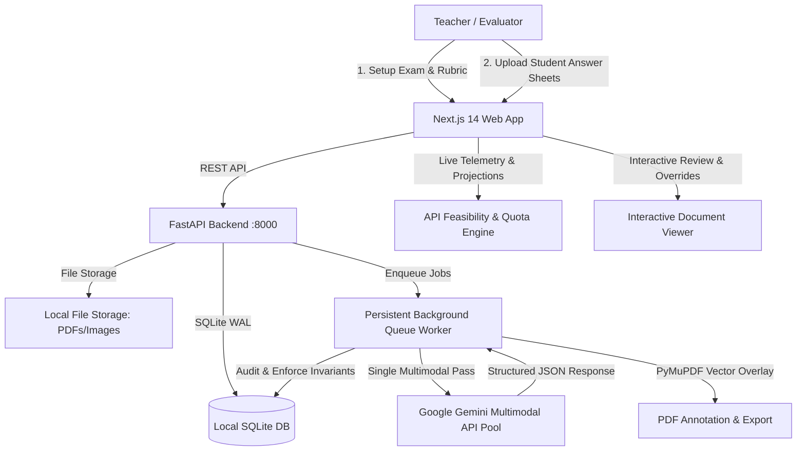

# PaperGrade AI — Phase 1 Proof of Concept (POC)

PaperGrade AI is a local-first, automated answer-sheet grading system built to experimentally evaluate whether the **Google Gemini multimodal API** can independently:
1. **Transcribe** handwritten answers from scanned multi-page student PDFs/images.
2. **Map** each handwritten answer to its corresponding question and subquestion.
3. **Localize** answer regions with normalized bounding boxes $[0, 1]$ on original pages.
4. **Grade** answers against a teacher-approved marking rubric with criterion-level breakdowns.
5. **Explain** marks awarded using concrete evidence from the student's text.
6. **Execute in a single multimodal pass** per student paper, eliminating separate OCR pipelines.
7. **Instrument telemetry**: Track token consumption, latency percentiles ($P_{50}$, $P_{95}$), retries, and project 40- and 50-paper batch feasibility against Google AI Studio quota limits.

---

## 🏗️ System Architecture

> [!NOTE]
> **Complete Technical Specification:**
> For an exhaustive, function-by-function breakdown of every module, background worker, database table, Pydantic schema, and frontend state machine from A to Z, read **[ARCHITECTURE.md](file:///c:/Users/tarun/Desktop/Github%20Repo/PaperGrade%20AI/ARCHITECTURE.md)**.



### Technology Stack
- **Backend:** Python 3.10+, FastAPI, Pydantic v2, PyMuPDF (`fitz`), Pillow, Official Google Gen AI SDK (`google-genai`).
- **Storage:** Local-first SQLite (`backend/data/papergrade.db`) with WAL mode and local filesystem for scans and exports.
- **Frontend:** Next.js 14 (App Router), React 18, TypeScript, Tailwind CSS, Lucide Icons.
- **AI Engine:** Google Gemini with 4-Key Failover Ring and 4-tier model fallback (`gemini-3.8-flash` primary -> `gemini-3.5-flash-lite` 500 RPD fallback -> `gemini-flash-lite-latest` -> `gemini-3.1-flash-lite`). Supports offline Mock Mode for testing without API keys.

---

## 🚀 Quickstart Guide

### 0. ⚡ 1-Click Launch (Windows)
Double-click **`start_papergrade.bat`** (or `run.bat`) at the root of the project. This will automatically:
1. Verify Python & Node.js environments.
2. Start the FastAPI backend & worker on `http://127.0.0.1:8000`.
3. Start the Next.js frontend on `http://localhost:3000`.
4. Open the teacher dashboard in your browser.

To stop both services at any time, run **`stop_papergrade.bat`**.

---

### 1. Prerequisites
- **Python 3.10+**
- **Node.js 18+** and `npm`
- *(Optional for Live AI)* A Google Gemini API Key from [Google AI Studio](https://aistudio.google.com/)

---

### 2. Environment Configuration

Copy `.env.example` to `.env` in the root directory:
```bash
cp .env.example .env
```

Configure your credentials in `.env`:
```env
# Google Gemini API Configuration
GEMINI_API_KEY=AIzaSy...your_actual_key_here
GEMINI_MODEL=gemini-2.5-flash

# Server Configuration
HOST=127.0.0.1
PORT=8000
DATA_DIR=./data

# User Quota Limits from Google AI Studio (Adjust to match your tier)
USER_RPM_LIMIT=15
USER_TPM_LIMIT=1000000
USER_RPD_LIMIT=1500

NEXT_PUBLIC_API_URL=http://localhost:8000
```
> **Note on Mock Mode:** If `GEMINI_API_KEY` is left blank or not found, PaperGrade AI automatically activates **Demo Mock Mode**. All mock results are clearly watermarked as simulated, recording `is_mock=1` in the database to prevent falsifying live experiment metrics.

---

### 3. Backend Setup & Run

1. Navigate to the backend directory and install Python dependencies:
```bash
cd backend
pip install -r requirements.txt
```

2. Start the FastAPI server (this automatically boots the persistent background queue worker):
```bash
python -m uvicorn backend.app.main:app --host 127.0.0.1 --port 8000 --reload
```
The backend API is now live at `http://127.0.0.1:8000`. You can inspect interactive OpenAPI documentation at `http://127.0.0.1:8000/docs`.

---

### 4. Frontend Setup & Run

1. In a separate terminal, navigate to the frontend directory:
```bash
cd frontend
npm install
```

2. Start the development server (or run production build):
```bash
# Development mode
npm run dev

# Or Production build and start
npm run build
npm start
```
The teacher dashboard is now accessible at **`http://localhost:3000`**.

---

### 5. Running Automated Backend Tests

PaperGrade AI includes unit and invariant tests covering Pydantic schema validation, grading invariants (bounds checking, manual override protection), PyMuPDF vector rendering, and statistical feasibility projections:

```bash
python -m pytest backend/tests -v
```

All 8 tests should pass:
- `test_schemas.py`: Coordinate clamping $[0, 1]$, region validation, and response models.
- `test_invariants.py`: Invariant enforcement: $0 \le \text{mark} \le \text{max}$, backend sum recalculation, and audit log generation.
- `test_pdf_service.py`: PDF validation, PyMuPDF page rendering, answer cropping, and vector annotation overlays.
- `test_usage_projections.py`: Latency percentiles ($P_{50}$, $P_{95}$), pacing calculations, and conservative 40/50 batch projections.

---

## 📋 Walkthrough & User Flows

### Step 1: Examination & Rubric Setup (`/exams/new`)
1. Create a new examination by uploading:
   - The **Question Paper** (PDF or images).
   - The **Official Answer Key** (PDF or images).
   - *(Optional)* Marking scheme guidance.
2. Alternatively, click **"Load Pre-packaged Sample Exam"** on the dashboard to instantly load a 20-mark Computer Science sample exam with 3 student submissions.
3. Gemini extracts a draft structured rubric containing Question IDs, maximum marks, model solutions, criteria points, and tolerance rules.
4. **Teacher Review & Approval:** The teacher reviews, edits, and explicitly locks/approves the rubric (`RubricEditor.tsx`). Once locked, this rubric serves as the immutable source of truth for all student submissions.

### Step 2: Student Submission & Processing (`/batches/[id]`)
1. Upload student answer sheets as multi-page PDFs or image files.
2. The system checks page ordering, dimensions, and creates submission records with statuses:
   $$\text{UPLOADED} \longrightarrow \text{QUEUED} \longrightarrow \text{PROCESSING} \longrightarrow \text{NEEDS\_REVIEW} \text{ or } \text{COMPLETED}$$
3. The persistent queue worker processes submissions one-by-one. Each request sends the student's multi-page document + confirmed compact rubric in a single prompt.
4. If the worker restarts, pending jobs in `PROCESSING` are automatically recovered and reset to `QUEUED`.

### Step 3: Interactive Grading & Annotation (`/submissions/[id]`)
1. Open any completed or review-pending student submission.
2. **Document Viewer:** Renders original high-resolution page scans with SVG/HTML bounding box overlays (`x`, `y`, `width`, `height`). Badges display `Q1 — 4/4` with semantic color coding (Green: Full marks, Amber: Partial, Rose: Zero, Violet: Review required).
3. **Grading Modal:** Clicking any answer region opens the detailed evaluation modal:
   - **Handwriting Crop:** Displays the exact image cropped from the student's sheet.
   - **Extracted Transcription:** Editable student text transcribed by AI.
   - **Official Answer & Marking Rubric:** Clear criteria comparison.
   - **Criterion Breakdown:** Sub-scores for each criterion with evidence quotes.
   - **Teacher Override:** Teachers can edit awarded marks, adjust transcriptions, update explanations, and resize/reposition bounding boxes.
   - **Audit Trail:** Every edit is recorded in `audit_logs` and instantly recalculates the student's total marks.

### Step 4: Class Marks Table & CSV Export (`/batches/[id]` - Tab 2)
1. View the full class results matrix with one column per question/subquestion.
2. Filter by status (`Finalized`, `Needs Review`, `Pending`).
3. Click **"Export Class CSV"** to download the complete spreadsheet.

### Step 5: Vector-Annotated PDF Export
1. On any student page, click **"Download Annotated PDF"**.
2. PyMuPDF renders vector rectangles, status headers, question tags, and awarded marks directly onto the student's original pages without degrading scan quality.
3. Batch export of all student PDFs as a ZIP archive is also available via the batch dashboard.

---

## 📊 API Telemetry & 40/50 Paper Feasibility Engine

Every single API attempt (including retries, failures, and token metrics) is written to the `api_usage_events` table in SQLite.

### Fields Captured in `api_usage_events`:
| Column | Description |
|---|---|
| `timestamp` | UTC ISO-8601 timestamp of request |
| `request_purpose` | `exam_setup`, `submission_grading`, or `retry` |
| `model_name` | Configured Gemini model (e.g., `gemini-2.5-flash`) |
| `input_tokens` | Prompt tokens consumed (document + rubric) |
| `output_tokens` | Generated tokens (transcriptions, reasoning, coords) |
| `thinking_tokens` | Extended thinking tokens (when enabled) |
| `cached_tokens` | Cached prompt tokens (if applicable) |
| `duration_ms` | Round-trip request latency in milliseconds |
| `page_count` | Number of document pages processed |
| `file_size_bytes` | Payload file size |
| `is_success` | Boolean (1 for success, 0 for failure) |
| `http_status` | HTTP response code (e.g., 200, 429, 503) |
| `estimated_cost_usd` | Calculated cost using Gemini Flash pricing ($0.075 / 1M input, $0.30 / 1M output) |
| `is_mock` | Flag indicating whether this was real Gemini or mock fixture |

### Feasibility Projections for 40 & 50 Submissions
The Feasibility Dashboard (`/usage`) calculates both **Average-Case** and **Conservative ($P_{90}$)** projections for processing batches of 40 and 50 papers:

$$\text{Projected Tokens} = \text{Setup Tokens} + N \times \text{Tokens}_{\text{per paper}} \times (1 + \text{Retry Rate})$$

$$\text{Estimated Processing Time} = N \times \left( \text{Duration}_{\text{per paper}} + \text{Pacing Delay} \right)$$

- **Pacing Delay:** Calculated automatically against the user's AI Studio **RPM limit** to ensure rate-limit errors (HTTP 429) are completely avoided.
- **Quota Constraints:** Flags whether the projected batch will exceed the configured Daily Request Quota (RPD) or Tokens Per Minute (TPM).

---

## 🔬 Experimental Observations & Limitations

1. **Bounding Box Precision:**
   - Gemini's normalized $[0, 1]$ bounding box predictions accurately delineate answer regions for clearly delineated questions (e.g., questions with clear "Ans:" labels or margins).
   - In unstructured answer sheets where answers bleed across columns or intermingle with scratch work, the model occasionally provides wider bounding boxes encompassing adjacent text.
   - *Mitigation:* PaperGrade AI provides full manual bounding-box repositioning and resizing in the UI, logging adjustments in the benchmark table.

2. **Handwriting Legibility & Hallucination Avoidance:**
   - Under poor scan contrast or heavily cursive handwriting, the prompt instructs Gemini to output `[illegible]` rather than hallucinating text, setting `needs_review=true` and `transcription_uncertainty > 0.5`.
   - The UI displays the original handwriting crop side-by-side with the transcription so teachers can confirm borderline cases in seconds.

3. **Single-Pass Multimodal Grading Feasibility:**
   - Performing transcription, question mapping, bounding box localization, and criterion grading in a single Gemini request is viable and cost-effective ($\sim \$0.001$ to $\$0.003$ per student submission on Gemini 2.5 Flash).
   - For a standard classroom batch of **40 students**, projected API cost is approximately **\$0.08 - \$0.12**, well within typical educational institution budgets.
   - On Google AI Studio's 15 RPM free tier, pacing the queue worker at 4–5 seconds between requests allows a 40-paper batch to process smoothly in approximately 8–10 minutes without hitting rate limits.

---

## 🔒 Security & Safe Handling

- **No Third-Party Cloud Leaks:** All document scans, rendered page images, database records, and exported PDFs remain strictly on the local filesystem.
- **Secret Isolation:** API keys are read strictly from backend environment variables and are never transmitted to the browser or bundled in client code.
